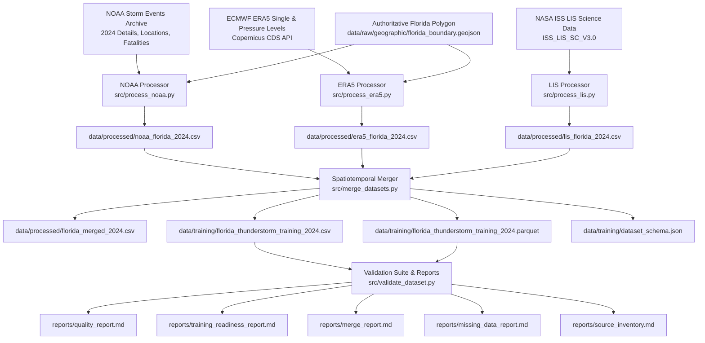

# Florida Thunderstorm Prediction Dataset (2024) Pipeline

A production-grade, reproducible data collection, harmonization, and machine learning preparation pipeline for thunderstorm prediction over the state of **Florida, United States**, for calendar year **2024**.

Consolidates three primary environmental data sources:

1. **NOAA Storm Events Database**: Ground-truth severe weather and convective storm impact reports.
2. **ECMWF ERA5 Atmospheric Reanalysis**: Multidimensional hourly atmospheric thermodynamic and kinematic state predictors.
3. **NASA ISS Lightning Imaging Sensor (ISS LIS)**: Satellite-based optical lightning observation records.

---

## Architecture & Workflow



---

## Directory Structure

```text
Florida_Thunderstorm_2024_Training/
│
├── README.md                           # Comprehensive documentation
├── requirements.txt                    # Project dependencies
├── pytest.ini                          # Testing configuration
│
├── config/
│   ├── project_config.yaml             # Bounding boxes, tolerances, target labels
│   └── variable_mapping.yaml           # Source-to-predictor schema mapping
│
├── data/
│   ├── raw/
│   │   ├── noaa/                       # StormEvents 2024 CSV.gz archives
│   │   ├── era5/
│   │   │   ├── single_levels/          # ERA5 single-level NetCDF files
│   │   │   └── pressure_levels/        # ERA5 pressure-level NetCDF files
│   │   ├── lis/                        # NASA LIS granules
│   │   └── geographic/                 # florida_boundary.geojson
│   │
│   ├── interim/
│   │   ├── noaa/                       # florida_events_interim.csv
│   │   ├── era5/                       # era5_florida_interim.nc
│   │   └── lis/                        # LIS intermediate tables
│   │
│   ├── processed/
│   │   ├── noaa_florida_2024.csv       # Standardized Florida NOAA events
│   │   ├── era5_florida_2024.csv       # Standardized masked ERA5 grid
│   │   ├── lis_florida_2024.csv        # LIS observation coverage grid
│   │   └── florida_merged_2024.csv     # Master aligned dataset
│   │
│   └── training/
│       ├── florida_thunderstorm_training_2024.csv       # Ascending-sorted CSV
│       ├── florida_thunderstorm_training_2024.parquet   # High-efficiency Parquet
│       └── dataset_schema.json                         # Feature metadata & null rates
│
├── src/
│   ├── __init__.py
│   ├── inspect_existing_data.py        # Workspace asset audit
│   ├── download_noaa.py                # NOAA ingestion / downloader
│   ├── download_era5.py                # Copernicus CDS API manager
│   ├── download_lis.py                 # NASA LIS auditor
│   ├── process_noaa.py                 # Florida NOAA polygon filter & timestamp cleaner
│   ├── process_era5.py                 # Coordinate normalizer & derived features
│   ├── process_lis.py                  # LIS viewing flag processor
│   ├── merge_datasets.py               # Spatiotemporal joiner & target builder
│   ├── validate_dataset.py             # 10-point integrity & quality validation
│   └── main.py                         # Unified CLI pipeline coordinator
│
├── tests/
│   ├── __init__.py
│   ├── conftest.py                     # Path configuration for test runner
│   ├── test_noaa.py                    # NOAA filtering & event ID tests
│   ├── test_era5.py                    # ERA5 unit conversions & Magnus RH tests
│   ├── test_lis.py                     # Scientific LIS no-false-zero rule tests
│   └── test_merged_dataset.py          # Sort, key uniqueness, & target tests
│
├── reports/
│   ├── source_inventory.md             # File-by-file pre-execution audit
│   ├── missing_data_report.md          # Comprehensive missingness & sensor audit
│   ├── download_manifest.csv           # File hashes, sizes, and timestamps
│   ├── quality_report.md               # 10-point validation audit summary
│   ├── merge_report.md                 # Spatiotemporal join statistics
│   └── training_readiness_report.md    # Leakage check & target distribution
│
└── logs/
    └── florida_pipeline.log            # Complete execution audit log
```

---

## Key Methodological Principles

### 1. Authoritative Geographic Filtering

- Uses the official **US Census Bureau / Natural Earth Florida state polygon boundary** (`data/raw/geographic/florida_boundary.geojson`).
- Explicitly includes the **Florida Peninsula**, **Florida Panhandle**, and **Florida Keys**.
- Rejects points in surrounding open water (Gulf of Mexico and Atlantic Ocean) while preserving valid coastal zones.

### 2. Physical Unit Conversions & Derived Features

- **Temperatures**: Converted from Kelvin ($K$) to Celsius ($^\circ\text{C}$).
- **Pressures**: Converted from Pascals ($\text{Pa}$) to Hectopascals ($\text{hPa}$).
- **Precipitation**: Converted from accumulated meters ($m$) to millimeters ($\text{mm}$).
- **10m Wind Speed**: Vector magnitude $\sqrt{u_{10}^2 + v_{10}^2}$ in $\text{m/s}$.
- **10m Wind Direction**: Meteorological direction from which wind blows ($0\text{--}360^\circ$).
- **2m Relative Humidity**: Calculated via the standard Magnus approximation:
  $$RH = 100 \times \frac{\exp\left(\frac{17.625 \cdot T_d}{243.04 + T_d}\right)}{\exp\left(\frac{17.625 \cdot T}{243.04 + T}\right)}$$

### 3. Critical LIS Scientific Constraint

- Absence of a satellite overpass must **NEVER** be imputed as zero lightning.
- Maintains independent fields: `lis_observation_coverage` ($0$ or $1$) and `lis_lightning_detected` ($1$, $0$, or $\text{NaN}$).
- When `lis_observation_coverage == 0`, `lis_lightning_detected` remains $\text{NaN}$ (unobserved), preventing machine learning models from learning false negative associations.

### 4. Defensible Training Target Definition

- **Class `1` (Confirmed Storm)**: NOAA severe convective event match (Thunderstorm Wind, Hail, Tornado, Lightning, etc.) or verified satellite lightning detection.
- **Class `0` (Confirmed Non-Storm)**: Quiescent, stable atmospheric column with $\text{CAPE} < 150\text{ J/kg}$ and zero precipitation.
- **Class `-1` (Unlabeled / Ambiguous)**: High buoyancy without ground impact reports or satellite overpasses. Preserved as unlabeled rather than manufacturing false negatives.

### 5. Target Leakage Prevention & Ascending Sort Order

- Predictors contain strictly thermodynamic, kinematic, and spatiotemporal coordinates.
- NOAA event IDs, narratives, damage values, and post-event flags are strictly excluded from predictor features.
- Files are strictly sorted in ascending order by `timestamp_utc`, `latitude`, `longitude` to allow time-series cross-validation without lookahead bias.

---

## CLI Execution Guide

From within the `Florida_Thunderstorm_2024_Training/` directory:

```powershell
# Run the complete automated pipeline end-to-end
python src/main.py run-all

# Or run individual modular stages:
python src/main.py inspect          # Audit existing workspace assets
python src/main.py download-noaa   # Acquire / reuse NOAA archives
python src/main.py download-era5   # Manage Copernicus ERA5 datasets
python src/main.py download-lis    # Check NASA LIS satellite availability
python src/main.py process-noaa    # Filter Florida NOAA events
python src/main.py process-era5    # Standardize & derive ERA5 features
python src/main.py process-lis     # Build LIS observation coverage grid
python src/main.py merge           # Align spatiotemporally & form targets
python src/main.py validate        # Run data quality audit suite
```

### Running Test Suite

```powershell
python -m pytest tests/ -v
```

All 6 tests validate state filtering, unit conversions, Magnus formula, composite key uniqueness, ascending sort order, and target assignment logic.

