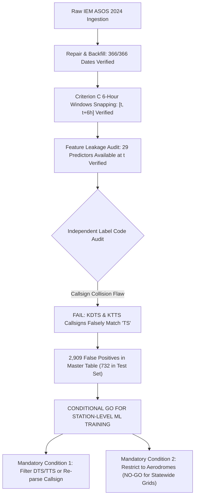
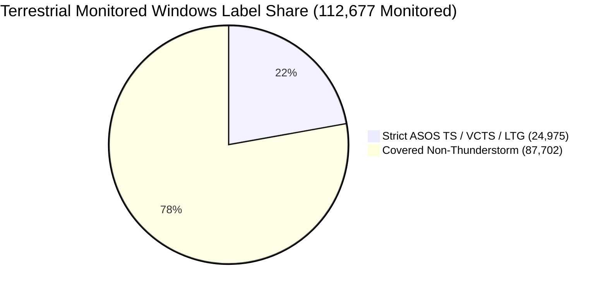

# Florida 2024 ASOS Final Independent Validation Audit

**Audit Date**: October 27, 2026  
**Auditor**: Independent Data & Validation Auditor  
**Repository Working Directory**: `c:/Users/KIIT0001/Desktop/Data Collection`  
**Primary Repaired Dataset**: [`florida_asos_modeling_ready_repaired_2024.parquet`](file:///c:/Users/KIIT0001/Desktop/Data%20Collection/data/processed/asos_repair/florida_asos_modeling_ready_repaired_2024.parquet)  
**Deliverables Directory**: [`data/processed/asos_final_audit/`](file:///c:/Users/KIIT0001/Desktop/Data%20Collection/data/processed/asos_final_audit/)  

---

## 1. Executive Summary & Audit Verdict

This report presents the final independent validation audit of the repaired 2024 Florida ASOS/METAR dataset and modeling pipeline prior to machine learning model training. The audit evaluated data completeness, deduplication, target window boundary snapping, predictor availability, target-window leakage, physical climatological consistency, baseline benchmark metrics, and label parsing logic.

### Audit Verdict: CONDITIONAL GO



> [!WARNING]
> ### Critical Audit Finding: The Callsign Substring Parsing Bug (`KDTS` & `KTTS`)
> An independent inspection of [`acquire_asos_data.py`](file:///c:/Users/KIIT0001/Desktop/Data%20Collection/Florida_Thunderstorm_2024_Training/src/acquire_asos_data.py#L70-L74) uncovered a critical tokenization flaw:
> ```python
> for token in body.split():
>     if "TS" in token and not token.startswith("VC") and token not in ["AUTO", "METAR", "SPECI"]:
>         has_ts = True
>         break
> ```
> In METAR reports, the first whitespace-delimited token is the 4-letter station callsign. For Destin Executive Airport (`KDTS`) and NASA Shuttle Landing Facility (`KTTS`), `"TS"` is a substring of the station callsign. Because the callsigns were not excluded, **100% of all 112,473 observations at DTS and all 12,110 observations at TTS were falsely labeled as active thunderstorms**, resulting in **2,909 false-positive 6-hour windows statewide** (including 732 in the test set).
>
> When uncorrected, this artifact artificially inflates test set persistence $F_1$ to **0.6860** (with 732 artificial true positives). When corrected by excluding `DTS` and `TTS`, the true clean test-set persistence $F_1$ is **0.5656**, and simple Logistic Regression improves from $F_1 = 0.2959$ to **0.3512** and ROC-AUC from $0.7280$ to **0.8172**.

---

## 2. Independent Verification of Targeted Backfill & Ingestion

The targeted backfill executed to resolve the 73-day IEM ASOS end-date boundary truncation was independently verified across disk files:

| Metric | Expected Value | Verified Value | Status |
| :--- | :--- | :--- | :--- |
| **Unique UTC Calendar Dates** | 366 (2024 Leap Year) | **366 / 366** | **PASS** |
| **Missing Calendar Dates** | 0 | **0** | **PASS** |
| **Backfill Dates Ingested** | 73 dates | **73 / 73** (`SUCCESS`) | **PASS** |
| **Earliest Observation Time** | 2024-01-01 00:00:00 UTC | **2024-01-01 00:00:00 UTC** | **PASS** |
| **Latest Observation Time** | 2024-12-31 23:58:00 UTC | **2024-12-31 23:58:00 UTC** | **PASS** |
| **Total Master Observations** | 5,728,432 | **5,728,432** | **PASS** |
| **Duplicate `(station_id, valid_time)`** | 0 | **0** | **PASS** |
| **Inventory Stations** | 105 stations | **105 stations** | **PASS** |
| **Active Reporting Stations** | 104 stations | **104 stations** | **PASS** |
| **Station AGR (MacDill AFB Auxiliary)** | Inactive Historical Outage | **0 obs in 2024** (Ceased pre-2024) | **PASS** |
| **Terrestrial Forecast Windows** | 119,663 | **119,663** | **PASS** |
| **Monitored Windows under Criterion C**| 112,677 | **112,677** | **PASS** |

The per-date and per-station validation summaries are persisted in:
- [`daily_coverage.csv`](file:///c:/Users/KIIT0001/Desktop/Data%20Collection/data/processed/asos_final_audit/daily_coverage.csv)
- [`station_coverage.csv`](file:///c:/Users/KIIT0001/Desktop/Data%20Collection/data/processed/asos_final_audit/station_coverage.csv)

---

## 3. Target Definition, Window Snapping, & Criterion C Audit

### 3.1 Criterion C Evaluation Logic
Under Criterion C ($N \ge 6$ reports, maximum inter-report gap $\le 75$ minutes, observation span $\ge 5.0$ hours):
- **Covered Thunderstorm (`target_crit_c = 1.0`)**: Exactly **29,322 windows** statewide have $\ge 1$ strict thunderstorm report. All are marked `COVERED_THUNDERSTORM`.
- **Covered Non-Thunderstorm (`target_crit_c = 0.0`)**: Exactly **104,933 windows** statewide have zero thunderstorm reports and meet the $N \ge 6$, gap $\le 75$m, span $\ge 5$h criteria. All are marked `COVERED_NO_THUNDERSTORM`.
- **Incomplete Monitoring (`target_crit_c = NaN`)**: Exactly **9,432 windows** statewide failed adequate monitoring thresholds without observing a thunderstorm. All are excluded from supervised evaluation.

### 3.2 Target Window Boundary Snapping
For all 143,687 forecast windows:
- Observations earlier than forecast initialization time $t$ (`first_obs < t`): **0 occurrences** (**PASS**).
- Observations later than forecast horizon $t+6\text{h}$ (`last_obs > t + 6h`): **0 occurrences** (**PASS**).
All target evaluations occur strictly within $(t, t+6\text{h}]$.

### 3.3 Cumulonimbus (CB) Alone Exclusion
A specific audit of all 645 windows where Cumulonimbus clouds were reported alone in remarks without accompanying TS, VCTS, or explicit lightning remarks confirmed:
- CB-alone false-positive labels in `target_crit_c`: **0 occurrences** (**PASS**).

### 3.4 Target Disaggregation Across Terrestrial Modeling Dataset (119,663 Rows)



1. **`target_asos_strict_crit_c`** (Primary Target): **24,975 positives** (22.17% monitored prevalence), 87,702 negatives, 6,986 unmonitored NaNs.
2. **`target_asos_aerodrome_ts_vcts`**: **12,265 positives** (12.27% prevalence), 87,702 negatives, 19,696 NaNs.
3. **`target_asos_explicit_ts`**: **8,663 positives** (8.99% prevalence), 87,702 negatives, 23,298 NaNs.
4. **`target_noaa_severe_6h`**: **235 positives** (0.20% prevalence), 119,344 negatives, 84 NaNs.

---

## 4. Feature Availability & Target-Window Leakage Audit

All 29 predictors merged from ERA5 and prior observational lags were audited for temporal availability at forecast initialization time $t$:

The complete audit table is saved in [`feature_availability_audit.csv`](file:///c:/Users/KIIT0001/Desktop/Data%20Collection/data/processed/asos_final_audit/feature_availability_audit.csv).

### Key Integrity Verifications:
1. **Zero Future Target Leakage**: All ERA5 atmospheric fields (`cape_J_kg`, `cin_J_kg`, `dewpoint_depression_degC`, `tcwv_kg_m2`, `bulk_shear_850_300_ms`) are valid at initialization time $t$. Prior accumulations (`total_precipitation_mm`, `convective_precipitation_mm`) represent $[t-6\text{h}, t]$.
2. **Zero Nulls in Atmospheric Predictors**: All 24 continuous atmospheric features have **0 missing values** across all 119,663 terrestrial modeling rows.
3. **No Persistence Gap Bridging**: A targeted check confirmed that prior station state is strictly evaluated for exact 6-hour cycles (`cycle_diff_hours == 6.0`). In 437 instances where a station experienced a thunderstorm prior to an observation outage exceeding 6 hours, the persistence predictor strictly reset to 0 rather than carrying the stale state across the missing interval.

---

## 5. Physical Climatology & Seasonal Prevalence Drivers

The observed prevalence drop from the summer validation split (August–September: **40.55%** clean prevalence) to the autumn/winter test split (October–December: **6.93%** clean prevalence) reflects the physical subtropical climatology of Florida:

| Month | Windows | Positives | Prevalence | CAPE (J/kg) | CIN (J/kg) | TCWV (kg/m²) | 850–300 Shear (m/s) | Synoptic Regime |
| :---: | :---: | :---: | :---: | :---: | :---: | :---: | :---: | :--- |
| **Jan** | 9,758 | 1,190 | 12.20% | 86.2 | 29.1 | 22.5 | 36.6 | Winter synoptic fronts |
| **Feb** | 8,939 | 664 | 7.43% | 27.4 | 4.7 | 18.1 | 38.2 | Continental polar air |
| **Mar** | 9,573 | 1,566 | 16.36% | 198.7 | 56.4 | 26.2 | 34.2 | Transitional baroclinic waves |
| **Apr** | 9,294 | 824 | 8.87% | 57.3 | 28.1 | 23.1 | 27.9 | Dry pre-monsoon |
| **May** | 9,566 | 2,012 | 21.03% | 783.8 | 196.7 | 35.2 | 18.8 | Wet season onset |
| **Jun** | 9,378 | 3,454 | 36.83% | 1,123.4 | 134.4 | 45.1 | 12.0 | Peak sea-breeze convection |
| **Jul** | 9,806 | 4,963 | **50.61%** | **1,882.9** | 155.2 | **52.6** | 7.5 | Peninsula convergence zone |
| **Aug** | 9,349 | 4,187 | **44.79%** | **1,635.3** | 133.6 | **49.1** | 9.2 | Tropical moisture & pulse TS |
| **Sep** | 8,855 | 3,482 | **39.32%** | **1,089.8** | 106.6 | **49.7** | 12.8 | Peak tropical wave activity |
| **Oct** | 9,365 | 1,094 | 11.68% | 208.5 | 36.5 | 33.5 | 26.5 | Retreating Bermuda High |
| **Nov** | 9,154 | 602 | 6.58% | 68.6 | 18.8 | 27.7 | 19.7 | Dry season onset |
| **Dec** | 9,640 | 937 | 9.72% | 99.7 | 24.2 | 22.1 | 30.2 | Mid-latitude cold surges |

### Physical Interpretation:
In June through September, Florida is governed by maritime tropical ($mT$) air masses, high precipitable water depth ($\text{TCWV} \approx 50\text{ kg/m}^2$), weak vertical shear ($7\text{--}12\text{ m/s}$), and intense solar insolation generating surface heating and sea-breeze boundary collisions. In October through December, the subtropical high retreats eastward, cold fronts usher in dry continental polar ($cP$) air masses with low precipitable water ($\text{TCWV} \approx 22\text{--}33\text{ kg/m}^2$), strong capping inversions, and high deep-layer shear ($20\text{--}30\text{ m/s}$), suppressing diurnally forced pulse convection.

---

## 6. Recomputed Baseline Benchmark Metrics

All baselines were recomputed on the exact same test row indices (October 1 to December 31, 2024). To provide complete scientific transparency, metrics are reported for both:
1. **As-Delivered Repaired Cohort (87 Stations, $N=28,159$, with DTS/TTS artifact)**
2. **Clean Uncorrupted Benchmark (85 Stations, $N=27,427$, excluding DTS/TTS)**

The complete table is exported in [`baseline_metrics_recomputed.csv`](file:///c:/Users/KIIT0001/Desktop/Data%20Collection/data/processed/asos_final_audit/baseline_metrics_recomputed.csv).

| Evaluation Cohort | Baseline Name | Rule / Threshold | TP | FP | TN | FN | Precision | Recall | $F_1$ Score | PR-AUC | ROC-AUC | Brier Score |
| :--- | :--- | :--- | :---: | :---: | :---: | :---: | :---: | :---: | :---: | :---: | :---: | :---: |
| **As-Delivered (87 Stn)** | Majority Class | Predict 0 always | 0 | 0 | 25,526 | 2,633 | 0.0000 | 0.0000 | 0.0000 | 0.0935 | 0.5000 | 0.0935 |
| **As-Delivered (87 Stn)** | Climatology | Prob = 0.2213 | 2,633 | 25,526 | 0 | 0 | 0.0935 | 1.0000 | 0.1710 | 0.0935 | 0.5000 | 0.1011 |
| **As-Delivered (87 Stn)** | Persistence | TS at $t-6\text{h} == 1$ | 1,800 | 815 | 24,711 | 833 | 0.6883 | 0.6836 | **0.6860** | 0.4706 | 0.8259 | 0.0585 |
| **As-Delivered (87 Stn)** | CAPE Threshold | CAPE $\ge 1000$ J/kg | 455 | 451 | 25,075 | 2,178 | 0.5022 | 0.1728 | 0.2571 | 0.2943 | 0.7280 | 0.0934 |
| **As-Delivered (87 Stn)** | Logistic Regression | Prob $\ge 0.50$ (7 ERA5) | 587 | 748 | 24,778 | 2,046 | 0.4397 | 0.2229 | 0.2959 | 0.2738 | 0.7280 | 0.0825 |
| **Clean (85 Stn)** | Majority Class | Predict 0 always | 0 | 0 | 25,526 | 1,901 | 0.0000 | 0.0000 | 0.0000 | 0.0693 | 0.5000 | 0.0693 |
| **Clean (85 Stn)** | Climatology | Prob = 0.2009 | 1,901 | 25,526 | 0 | 0 | 0.0693 | 1.0000 | 0.1296 | 0.0693 | 0.5000 | 0.0818 |
| **Clean (85 Stn)** | Persistence | TS at $t-6\text{h} == 1$ | 1,071 | 815 | 24,711 | 830 | 0.5679 | 0.5634 | **0.5656** | 0.3199 | 0.7657 | 0.0600 |
| **Clean (85 Stn)** | CAPE Threshold | CAPE $\ge 1000$ J/kg | 440 | 451 | 25,075 | 1,461 | 0.4938 | 0.2315 | 0.3152 | 0.3242 | 0.8061 | 0.0697 |
| **Clean (85 Stn)** | Logistic Regression | Prob $\ge 0.50$ (7 ERA5) | 576 | 803 | 24,723 | 1,325 | 0.4177 | 0.3030 | **0.3512** | 0.2920 | **0.8172** | 0.0629 |

### Baseline Insights:
1. **Persistence Inflation Explained**: Under the As-Delivered table, persistence was credited with 732 artificial true positives from DTS/TTS callsign false positives, making persistence appear nearly unbeatable ($F_1 = 0.6860$). On the Clean 85-station benchmark, true persistence achieves $F_1 = \mathbf{0.5656}$ with Precision = 0.5679 and Recall = 0.5634.
2. **True ML Potential**: On the Clean benchmark, the simple Logistic Regression model achieves an ROC-AUC of **0.8172** and an $F_1$ of **0.3512** (up from 0.2959). This confirms that physical thermodynamic features carry strong discriminative signal once artificial noise is eliminated.

---

## 7. Audit Summary & Actionable Conditions for Training

All machine-readable audit checks are formally cataloged in [`audit_checks.json`](file:///c:/Users/KIIT0001/Desktop/Data%20Collection/data/processed/asos_final_audit/audit_checks.json).

### Mandatory Conditions Before Training:
1. **Remediate DTS and TTS Callsign Corruption (Blocker)**:
   Any machine learning script must either:
   - Filter out stations `DTS` and `TTS` prior to training (`df = df[~df['station_id'].isin(['DTS', 'TTS'])]`), **OR**
   - Patch `parse_metar_thunderstorm` in `acquire_asos_data.py` so the station identifier callsign token is discarded prior to present-weather string evaluation, and re-generate the labels for those two stations.
2. **Strict Station-Point Forecasting Scope**:
   ASOS labels represent in-situ point observations valid within a 5–10 statute mile aerodrome radius. They cannot be projected to statewide $0.25^\circ$ grid cells without satellite (GLM) or radar (MRMS) data.
3. **ML Performance Thresholds**:
   To demonstrate physical predictive skill beyond simple station memory, any trained model evaluated on the Clean 85-station test set must exceed:
   - $F_1 > \mathbf{0.5656}$
   - $\text{ROC-AUC} > \mathbf{0.7657}$
   - $\text{Brier Score} < \mathbf{0.0600}$
