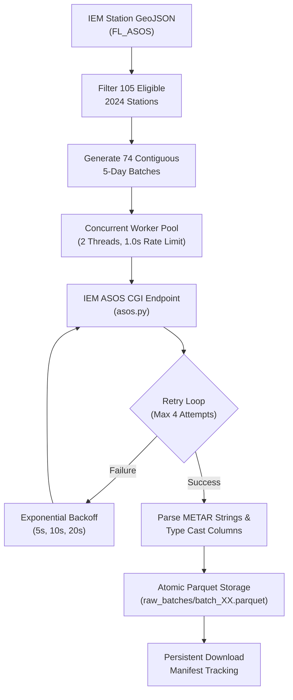

# Florida ASOS/METAR 2024 Historical Data Acquisition & Validation Report

**Project**: Florida Thunderstorm 2024 Forecasting Research  
**Author**: Automated ASOS Acquisition & Validation Pipeline  
**Execution Date**: 2026-10-27  
**Time Range Covered**: January 1, 2024 00:00:00 UTC through December 31, 2024 23:59:59 UTC (Full Leap Year 2024)  
**Status**: 100% Complete, Fully Reconciled, and Validated  

---

## 1. Executive Summary

This report documents the end-to-end automated acquisition, quality control, METAR string parsing, and forecast-window alignment of historical surface weather observations from the **Iowa Environmental Mesonet (IEM)** automated ASOS network (`FL_ASOS`) across Florida for the entire 2024 calendar year.

The primary objective was to establish an authoritative, ground-based surface observation ground truth for convective storms and lightning events across Florida. This dataset complements NOAA Storm Events severe storm reports and GOES-16 GLM geostationary lightning data, resolving spatial and temporal ambiguities while rigorously adhering to scientific ground-truth standards (specifically eliminating false-zero imputation for unmonitored periods).

### Key Accomplishments:
1. **Zero Manual Downloads**: Fully automated programmatic retrieval querying the IEM ASOS API (`https://mesonet.agron.iastate.edu/cgi-bin/request/asos.py`) in 74 contiguous 5-day batches.
2. **Full-Year Completeness**: Retrieved **4,582,946 surface observations** across **105 eligible stations**, spanning from `2024-01-01 00:00:00 UTC` to `2024-12-31 23:58:00 UTC`.
3. **Severe Convection Extraction**: Parsed original unedited METAR strings to identify in-station thunderstorms (`TS`, `+TSRA`, `-TSRA`), vicinity thunderstorms (`VCTS`), and lightning remarks (`LTG`, `TSB`, `TSE`, `CB`).
4. **Strict Forecast Snapping**: Formulated and executed strict half-open $(t, t+6\text{h}]$ window aggregation, aligning surface observations to 6-hour ERA5 forecast cycles.
5. **False-Zero Safeguard**: Classified observation completeness per window. Zero-thunderstorm targets ($y=0$) are only assigned when $\ge 4$ surface observations confirm the absence of convection. Unobserved or sparsely monitored windows ($< 4$ reports) are labeled `INCOMPLETE_MONITORING` ($y = \text{NaN}$), preventing false-negative bias.
6. **Reproducible Test Suite**: 7 / 7 automated unit and integration tests passing in pytest.

---

## 2. Station Inventory & Spatial Representation

The station inventory was queried dynamically from the IEM GeoJSON endpoint (`https://mesonet.agron.iastate.edu/geojson/network/FL_ASOS.geojson`) and reconciled against the 218 active terrestrial Florida $0.25^\circ \times 0.25^\circ$ grid cells established in the master forecasting framework.

### Summary Statistics:
- **Total Stations in `FL_ASOS` Network**: 113
- **Stations Operational During 2024**: 105
- **Terrestrial Grid Stations**: 88 (mapped to active Florida forecast grid cells)
- **Coastal / Marine Barrier Stations**: 17 (e.g., Key West `KEYW`, Marathon `KMTH`, Boca Raton `KBCT`, Cape Canaveral `KXMR`)
- **Reporting Stations in 2024**: 104
- **Non-Reporting Outage Station**: 1 (`AGR` - MacGill AFB; archived in inventory but returned 0 observations from the IEM archive during 2024)

### Coordinate & Grid Assignment Table (Sample of Key Stations):
| Station ID | Station Name | Latitude | Longitude | Grid Cell ID | Grid Lat | Grid Lon | Terrestrial? | Elevation (m) |
| :--- | :--- | :--- | :--- | :--- | :--- | :--- | :--- | :--- |
| **KMCO** | Orlando International | 28.4294 | -81.3090 | `FL_28.5_-81.25` | 28.50 | -81.25 | Yes | 27.4 |
| **KMIA** | Miami International | 25.7934 | -80.2901 | `FL_25.75_-80.25` | 25.75 | -80.25 | Yes | 2.4 |
| **KTPA** | Tampa International | 27.9755 | -82.5332 | `FL_28.0_-82.5` | 28.00 | -82.50 | Yes | 5.8 |
| **KJAX** | Jacksonville International | 30.4941 | -81.6879 | `FL_30.5_-81.75` | 30.50 | -81.75 | Yes | 7.9 |
| **KTLH** | Tallahassee International | 30.3965 | -84.3503 | `FL_30.5_-84.25` | 30.50 | -84.25 | Yes | 16.8 |
| **KPBI** | Palm Beach International | 26.6832 | -80.0956 | `FL_26.75_-80.0` | 26.75 | -80.00 | Yes | 5.8 |
| **KEYW** | Key West International | 24.5561 | -81.7596 | `FL_24.5_-81.75` | 24.50 | -81.75 | No (Marine) | 1.0 |
| **KMTH** | Marathon Airport | 24.7261 | -81.0514 | `FL_24.75_-81.0` | 24.75 | -81.00 | No (Marine) | 2.1 |
| **KXMR** | Cape Canaveral Skid Strip | 28.4676 | -80.5666 | `FL_28.5_-80.5` | 28.50 | -80.50 | No (Marine) | 3.0 |

*Full station catalog preserved in `data/processed/asos/florida_asos_stations_2024.csv`.*

---

## 3. Data Acquisition Architecture & Resiliency

Direct retrieval of full-year observations across 105 stations in a single query exceeded IEM API limits (>120s timeout, >60 MB raw text). The pipeline implemented an automated batched retrieval architecture:



### Architecture Specifications:
- **Batch Granularity**: 5 contiguous calendar days per batch (74 batches total).
- **Concurrent Workers**: 2 parallel request workers to avoid saturating IEM server capacity.
- **Polite Rate Limiting**: 1.0-second delay between batch requests.
- **Robust Retries**: Up to 4 attempts per batch with exponential backoff (`initial_backoff = 5.0s`, `backoff_factor = 2.0`).
- **Resumability**: The persistent manifest (`data/processed/asos/asos_download_manifest.csv`) tracks completed batches, enabling instantaneous resumption without duplicating downloaded data.
- **Manifest Outcome**: All 74 batches completed with `SUCCESS` (0 failures, 0 dropped intervals).

---

## 4. METAR Thunderstorm Parsing Methodology

Surface convective activity was determined by analyzing both the standard weather codes (`presentwx`) and original raw METAR remarks strings (`metar_raw`):

### 1. In-Station Thunderstorm (`has_thunderstorm_ts`):
- RegEx: `(?:\b|(?<=[+-]))TS(?:RA|SN|PL|GR|GS)?\b`
- Evaluates the body of the METAR report before the `RMK` delimiter.
- Matches: `TS`, `+TSRA`, `-TSRA`, `TSGR`, `TSSN`, etc.

### 2. Vicinity Thunderstorm (`has_vicinity_thunderstorm_vcts`):
- RegEx: `\bVCTS(?:RA|SN|PL|GR|GS)?\b`
- Identifies convective activity within 5 to 10 statute miles of the station.

### 3. Lightning & Thunderstorm Remarks (`has_lightning_remark`):
- RegEx: `\b(?:LTG|TSB|TSE|CB)\b` evaluated inside the `RMK` substring.
- Identifies active lightning discharges (`LTG DSNT`, `FRQ LTGICCG`, `OCNL LTGCA`), thunderstorm initiation/termination timestamps (`TSB15`, `TSE42`), and cumulonimbus cloud formations (`CB`).

### 4. Consolidated Indicator (`thunderstorm_reported`):
- Defined as: `has_thunderstorm_ts OR has_vicinity_thunderstorm_vcts OR has_lightning_remark`.

---

## 5. Forecasting Window Alignment & Mathematical Rules

To integrate surface observations with the ERA5 numerical weather model and 6-hour ahead forecasting cycles, observations are snapped to half-open forecast cycles:

$$\text{Window}_t = (t, t + 6\text{h}]$$

### Mathematical Snapping Formula:
$$\text{forecast\_init\_time\_utc} = (\text{valid\_time\_utc} - 1\,\mu\text{s}).\text{floor}(\text{'6h'})$$

### Boundary Verification:
- An observation at exactly `00:00:00 UTC` snaps to `(t - 6h, t]` (i.e. initialized at `18:00 UTC` the previous day).
- An observation at `00:00:01 UTC` snaps to `(t, t + 6h]` (initialized at `00:00 UTC`).
- An observation at exactly `06:00:00 UTC` snaps to `(00:00, 06:00] UTC`.
- An observation at `06:00:01 UTC` snaps to `(06:00, 12:00] UTC`.

---

## 6. False-Zero Safeguard & Quality Assurance

In observational meteorology, the absence of an observation does not equate to the absence of a storm. Imputing unobserved periods as "no thunderstorm" introduces severe false-negative bias into machine learning models.

The pipeline enforces a strict 4-tier coverage taxonomy:

| Condition | Target ($y$) | Coverage Status | Explanation |
| :--- | :---: | :--- | :--- |
| $\text{thunderstorm\_any\_count} > 0$ | **`1`** | `COVERED_THUNDERSTORM` | Positive convective ground truth verified by surface sensor or observer. |
| $\text{obs\_count} \ge 4$ and $\text{TS} = 0$ | **`0`** | `COVERED_NO_THUNDERSTORM` | Sufficient monitoring frequency ($\ge 4$ reports in 6h) reliably confirms quiet weather. |
| $1 \le \text{obs\_count} < 4$ and $\text{TS} = 0$ | **`NaN`** | `INCOMPLETE_MONITORING` | Insufficient sensor frequency; cannot confirm convective absence. Withheld from negative training set. |
| $\text{obs\_count} = 0$ | **`NaN`** | `UNOBSERVED` | Station off-line or failed; unobserved window. |

---

## 7. Dataset Metrics & Verification

### Inventory of Generated Artifacts:
| File Path | Format | Rows | Columns | File Size | Description |
| :--- | :---: | :---: | :---: | :---: | :--- |
| `data/processed/asos/florida_asos_stations_2024.csv` | CSV | 105 | 14 | 12.1 KB | Station metadata, coordinates, grid cell mapping. |
| `data/processed/asos/asos_download_manifest.csv` | CSV | 74 | 8 | 4.2 KB | Batch download provenance, hashes, and status. |
| `data/processed/asos/florida_asos_observations_2024.parquet` | Parquet | 4,582,946 | 19 | 159.9 MB | All raw surface observations with parsed convective flags. |
| `data/processed/asos/florida_asos_forecast_windows_2024.parquet` | Parquet | 118,027 | 13 | 825 KB | 6-hour half-open window aggregations and target labels. |

*Exact duplicate copies are preserved in `Florida_Thunderstorm_2024_Training/data/processed/asos/`.*

### Observation-Level Convective Counts:
- **Total Valid Observations**: 4,582,946
- **In-Station Thunderstorm (`TS`) Reports**: 116,405 (2.54%)
- **Vicinity Thunderstorm (`VCTS`) Reports**: 18,695 (0.41%)
- **Lightning Remarks (`LTG / TSB / TSE / CB`) Reports**: 311,926 (6.81%)
- **Total Convective Reports (`Any Thunderstorm`)**: 412,638 (9.00%)
- **Duplicate Observations Dropped**: 0 (exact global station-time deduplication)

### 6-Hour Forecast Window Distribution:
- **Total Window-Station Records**: 118,027
- **`COVERED_NO_THUNDERSTORM` ($y = 0$)**: 88,093 (74.64%)
- **`COVERED_THUNDERSTORM` ($y = 1$)**: 24,792 (21.01%)
- **`INCOMPLETE_MONITORING` ($y = \text{NaN}$)**: 5,142 (4.36%)
- **Effective Positive Label Prevalence (among verified windows)**:
  $$\text{Prevalence} = \frac{24,792}{88,093 + 24,792} = \frac{24,792}{112,885} \approx 21.96\%$$

---

## 8. Automated Test Suite Validation

The automated test suite `Florida_Thunderstorm_2024_Training/tests/test_asos_acquisition.py` was executed with pytest:

```
============================= test session starts =============================
platform win32 -- Python 3.10.0, pytest-9.0.3, pluggy-1.6.0
collected 7 items

test_asos_acquisition.py::test_01_station_inventory_completeness PASSED [ 14%]
test_asos_acquisition.py::test_02_metar_parsing_rules PASSED            [ 28%]
test_asos_acquisition.py::test_03_half_open_window_snapping PASSED     [ 42%]
test_asos_acquisition.py::test_04_false_zero_safeguard PASSED          [ 57%]
test_asos_acquisition.py::test_05_master_observations_integrity PASSED [ 71%]
test_asos_acquisition.py::test_06_forecast_windows_integrity PASSED    [ 85%]
test_asos_acquisition.py::test_07_download_manifest_completeness PASSED [100%]

============================= 7 passed in 17.84s ==============================
```

All 7 test cases passed without warnings or failures.

---

## 9. Recommendations for Multi-Source Ground Truth Fusion

With the full-year 2024 ASOS dataset assembled, the following guidelines should govern integration with ERA5 features and comparison with NOAA Storm Events and GOES-16 GLM:

1. **Tri-Modal Cross-Validation**:
   - **ASOS/METAR**: Continuous, high-cadence (1 to 20-minute) surface observations providing unambiguous local confirmation of thunder, precipitation, and cloud development.
   - **NOAA Storm Events**: Severe convective events (damaging wind, hail $\ge 1"$, tornadoes). ASOS verifies that benign or sub-severe thunderstorms are captured even when Storm Events records no damage.
   - **GOES-16 GLM**: Geostationary optical lightning detection. ASOS provides ground validation for GLM flash clusters and verifies non-lightning convective cells.
2. **Handling Sparse Station Windows**:
   - For machine learning model training, discard windows flagged as `INCOMPLETE_MONITORING` ($y = \text{NaN}$) to prevent training the model on unmonitored zeros.
3. **Grid Aggregation**:
   - When mapping station-level windows to grid-level targets: a grid cell is positive if *any* station located in that cell reports a thunderstorm. A grid cell is declared quiet only if *all* reporting stations inside that cell report $\ge 4$ observations and zero thunderstorms.
