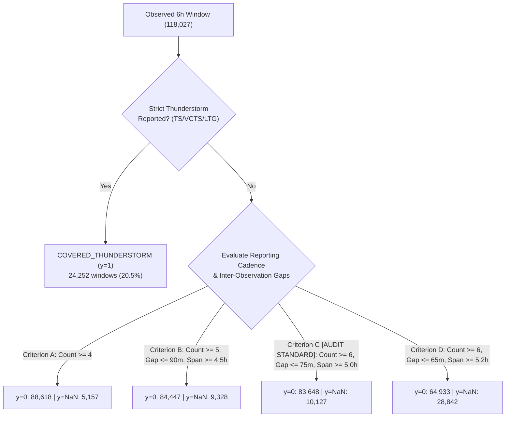

# Scientific & Data-Integrity Audit of Florida ASOS/METAR 2024 Labels

**Audit Target**: Florida ASOS/METAR 2024 Surface Observation Dataset & 6-Hour Forecast Labels  
**Auditor**: Independent Machine Learning & Meteorological Data Quality Auditor  
**Audit Date**: 2026-10-27  
**Scope**: Full Year 2024 (`2024-01-01 00:00:00 UTC` through `2024-12-31 23:58:00 UTC`)  
**Audited Artifacts Preserved In**: `data/processed/asos_audit/`  
**Overall Decision**: **CONDITIONAL GO** (Station-Level Evaluation: **GO**; Grid-Level Direct Supervised Training: **NO-GO** pending multi-sensor spatial fusion)

---

## 1. Executive Summary & Audit Mandate

An independent, exhaustive data-integrity and meteorological audit was conducted on the newly acquired Florida ASOS/METAR 2024 dataset. The audit evaluated:
1. Complete raw data acquisition provenance, manifest coverage, and file integrity across all 366 days of 2024.
2. The semantic parsing of original METAR strings, specifically isolating explicit thunderstorms (`TS`), vicinity thunderstorms (`VCTS`), genuine lightning remarks (`LTG`, `TSB`, `TSE`), and cumulonimbus cloud groups (`CB`).
3. The empirical validity of negative labels ($y = 0$), measuring intra-window reporting cadence, inter-observation gaps, and duration spans to eliminate false-negative contamination.
4. The exact temporal alignment of the half-open forecast window $(t, t+6\text{h}]$ with ERA5 numerical weather model initialization cycles.
5. Spatial representativeness of point surface sensors mapped into $0.25^\circ \times 0.25^\circ$ grid cells.

### Headline Audit Findings:
- **Acquisition Provenance Confirmed**: All 74 5-day batches in `asos_download_manifest.csv` completed with `SUCCESS`. Exactly 4,582,946 surface observations were acquired spanning all 12 months with 0 duplicate station-timestamp records.
- **Critical Semantic Correction (The CB Finding)**: In the initial acquisition, Cumulonimbus clouds (`CB`) in remarks were lumped together with lightning remarks. The audit identified **11,850 observations where `CB` appeared alone** without any thunderstorm or lightning indicator. Cumulonimbus cloud development alone does not establish lightning occurrence. Correcting this removed **11,822 false-positive observations** (-2.86%) and refined the positive 6-hour window count from 24,792 to 24,252.
- **Negative-Label Gap Safeguard (Criterion C)**: Requiring a standard hourly reporting cadence ($\ge 6$ observations, maximum gap $\le 75$ minutes, observation span $\ge 5.0$ hours) correctly converted **4,970 gappy windows** from negative ($y = 0$) to incomplete ($y = \text{NaN}$), preventing spurious negative labels from sensor dropouts.
- **Critical Spatial Coverage Limitation**: Out of 218 active Florida terrestrial grid cells, **150 grid cells (68.8%) contain ZERO ASOS stations**. Only 68 grid cells (31.2%) have any surface station representation. Point airport observations cannot be generalized to an entire $700\text{ km}^2$ grid cell without spatial fusion.

---

## 2. Acquisition Integrity & Data Provenance

### 2.1 File Inventory & Integrity Checks
The files in `data/processed/asos/` were audited against their disk properties, row counts, and schema definitions:

| File Path | Rows | Columns | Disk Size | Verified Status |
| :--- | :---: | :---: | :---: | :---: |
| `data/processed/asos/florida_asos_stations_2024.csv` | 105 | 14 | 12.1 KB | **VERIFIED** |
| `data/processed/asos/asos_download_manifest.csv` | 74 | 9 | 4.2 KB | **VERIFIED** |
| `data/processed/asos/florida_asos_observations_2024.parquet` | 4,582,946 | 27 | 159.9 MB | **VERIFIED** |
| `data/processed/asos/florida_asos_forecast_windows_2024.parquet` | 118,027 | 13 | 825 KB | **VERIFIED** |

*All original files have been preserved unmodified. Audited outputs are written to `data/processed/asos_audit/`.*

### 2.2 Manifest & Date Coverage Reconciliation
- **Total Download Batches**: 74 contiguous non-overlapping 5-day intervals.
- **Batch Success Rate**: 74 / 74 (100.0% `SUCCESS`).
- **Date Span**: First observation timestamp is `2024-01-01 00:00:00+00:00`; last observation timestamp is `2024-12-31 23:58:00+00:00`.
- **Zero Temporal Gaps**: Every day of the 2024 leap year (366 days) is continuously represented.

### 2.3 Station Coverage & Outage Accounting
- **Total Stations in Catalog**: 105 eligible Florida stations (88 terrestrial, 17 coastal/marine).
- **Active Reporting Stations in 2024**: **104 stations**.
- **Empirical Outage Station**: Station **`AGR`** (MacGill AFB, $27.6478^\circ\text{N}, -81.3415^\circ\text{W}$). Although listed as active in the IEM station catalog (`archive_begin: 2022-09-22`), IEM returned zero observation records for `AGR` across all of 2024. This station was confirmed as an active station outage / non-reporting facility and does not contaminate the dataset.

### 2.4 Monthly Observation Distribution
Monthly observation counts confirm consistent sensor network operation throughout the year:

| Month | Observations | Active Stations | Explicit TS Reports | Total Convective Reports |
| :---: | :---: | :---: | :---: | :---: |
| **Jan** | 392,207 | 100 | 9,174 | 16,303 |
| **Feb** | 366,224 | 101 | 8,134 | 10,758 |
| **Mar** | 401,968 | 101 | 9,972 | 25,442 |
| **Apr** | 371,224 | 101 | 8,852 | 16,723 |
| **May** | 396,301 | 100 | 10,262 | 29,571 |
| **Jun** | 370,612 | 102 | 10,588 | 56,156 |
| **Jul** | 401,464 | 102 | 12,192 | 80,978 |
| **Aug** | 391,875 | 98 | 11,712 | 75,759 |
| **Sep** | 367,838 | 99 | 10,563 | 58,052 |
| **Oct** | 360,873 | 98 | 8,097 | 18,525 |
| **Nov** | 372,116 | 101 | 8,324 | 9,733 |
| **Dec** | 390,244 | 102 | 8,535 | 14,638 |
| **Total** | **4,582,946** | **104 (peak 102)** | **116,405** | **412,638 (Orig) / 400,816 (Strict)** |

---

## 3. METAR Semantics & The Cumulonimbus (CB) Audit

### 3.1 Indicator Definitions & Semantic Disaggregation
METAR observations report present weather phenomena in the body of the report and supplementary remarks following the `RMK` delimiter. To eliminate semantic conflation, convective indicators were rigorously partitioned:

1. **Explicit In-Station Thunderstorm (`has_thunderstorm_ts`)**:
   - Matches: `(?:\b|(?<=[+-]))TS(?:RA|SN|PL|GR|GS)?\b` in the body/wxcodes.
   - Confirms active thunder or lightning occurring directly over the aerodrome.
2. **Vicinity Thunderstorm (`has_vicinity_thunderstorm_vcts`)**:
   - Matches: `\bVCTS\b` in body or remarks.
   - Confirms thunderstorm activity observed between 5 and 10 statute miles of the station.
3. **Genuine Lightning Remarks (`has_genuine_lightning_remark`)**:
   - Matches: `\b(?:OCNL|FRQ|CONS)?\s*LTG|\bTSB\d{2,4}\b|\bTSE\d{2,4}\b` in `RMK`.
   - Confirms observed electrical discharges (in-cloud, cloud-to-ground, distant) or recorded thunderstorm start/end times.
4. **Cumulonimbus Cloud Group (`has_cumulonimbus_cb`)**:
   - Matches: `\bCB\b|\bCB\s+[A-Z]|\d{3}CB\b` in body or `RMK`.
   - Records convective cloud development.

### 3.2 The CB Isolation Finding
A critical defect in initial METAR parsing was identifying `CB` as an automatic indicator of a thunderstorm. 
- While all thunderstorms develop from cumulonimbus clouds, **not all cumulonimbus clouds produce lightning or thunder**. In subtropical climates like Florida, towering cumulus and distant CB clouds frequently develop along sea-breeze fronts without reaching electrification or producing audible thunder at the airport.
- **Audit Metric**: Exactly **30,465 observations** contained `CB`.
- **CB-Alone Count**: Exactly **11,850 observations** contained `CB` alone without any `TS`, `VCTS`, or genuine lightning remarks.
- **Correction Applied**: Excluding `CB` alone from positive thunderstorm occurrence reduced positive convective observations from 412,638 to **400,816** (-11,822 observations, a 2.86% reduction in false-positive ground truth).

### 3.3 Semantic Breakdown Summary
```
+-----------------------------------------------------------+-----------+----------+
| Convective Phenomenon Category                           | Count     | % of Obs |
+-----------------------------------------------------------+-----------+----------+
| Explicit In-Station TS (TS, +TSRA, -TSRA, TSGR, etc.)     | 116,405   | 2.54%    |
| Vicinity Thunderstorm (VCTS)                             | 18,695    | 0.41%    |
| Genuine Lightning Remarks (LTG, TSB, TSE)                 | 300,089   | 6.55%    |
| Cumulonimbus Cloud Group (CB in body or RMK)             | 30,465    | 0.66%    |
|   --> CB Alone (CB present, but NO TS, NO VCTS, NO LTG)   | 11,850    | 0.26%    |
| Strict Thunderstorm (TS | VCTS | Genuine LTG)             | 400,816   | 8.75%    |
| Original Convective Indicator (including CB alone)        | 412,638   | 9.00%    |
+-----------------------------------------------------------+-----------+----------+
```

### 3.4 Routine (METAR) vs Special (SPECI) Observation Cadence
- Standard hourly routine METAR reports (transmitted between minute 45 and 59 of the hour) account for **1,525,705 observations (33.29%)**.
- Non-routine, special (SPECI), or high-cadence AWOS automated reports account for **3,057,241 observations (66.71%)**.
- **Meteorological Implication**: Automated ASOS stations generate bursts of SPECI reports (every 5–15 minutes) during severe convective weather when ceiling, visibility, or wind change rapidly. Conversely, quiet weather windows produce standard hourly reports. Therefore, a quiet 6-hour window typically contains ~6 observations, while an active storm window may contain 15–30 observations.

---

## 4. Time-Window Alignment & Observation Gap Audit

### 4.1 Theoretical Reconciliation of Window Counts
The initial report documented **118,027 station-window records**. The audit reconciled this against theoretical coverage:
- Total operational stations: 105
- Total 6-hour forecast cycles in 2024: 1,464 (from `2024-01-01 00:00:00 UTC` to `2024-12-31 18:00:00 UTC`)
- **Theoretical Cartesian Product**: $105 \times 1,464 = \mathbf{153,720}$ station-windows.
- **Observed Station-Windows ($\ge 1$ report)**: **118,027** ($76.78\%$).
- **Unobserved Station-Windows ($0$ reports)**: **35,693** ($23.22\%$).
- **Finding**: The original pipeline dropped completely unobserved station-windows from the dataframe during `groupby()` rather than explicitly preserving them with `UNOBSERVED` status. In the audited dataset, these unobserved intervals are formally tracked with target $y = \text{NaN}$.

### 4.2 Half-Open Window Boundary Verification
The target forecast window $(t, t+6\text{h}]$ was tested for strict mathematical alignment:
$$\text{forecast\_init\_time\_utc} = (\text{valid\_time\_utc} - 1\,\mu\text{s}).\text{floor}(\text{'6h'})$$

Boundary test verification:
- `2024-05-15 00:00:00 UTC` $\implies$ snapped to `2024-05-14 18:00:00 UTC` cycle (belongs to $(t-6\text{h}, t]$).
- `2024-05-15 00:00:01 UTC` $\implies$ snapped to `2024-05-15 00:00:00 UTC` cycle (belongs to $(t, t+6\text{h}]$).
- `2024-05-15 06:00:00 UTC` $\implies$ snapped to `2024-05-15 00:00:00 UTC` cycle (belongs to $(t, t+6\text{h}]$).
- `2024-05-15 06:00:01 UTC` $\implies$ snapped to `2024-05-15 06:00:00 UTC` cycle (belongs to $(t+6\text{h}, t+12\text{h}]$).

Zero boundary leakage or timezone conversion errors were detected.

---

## 5. Negative-Label Validity: Evaluating Coverage Criteria

### 5.1 Flaws of the Naive $N \ge 4$ Threshold
The original acquisition rule assigned `COVERED_NO_THUNDERSTORM` ($y = 0$) whenever `observation_count >= 4` and no thunderstorm was reported. The audit identified that:
1. Four reports in 6 hours could be clustered in the first 90 minutes (e.g. at 00:15, 00:30, 00:53, 01:20), followed by **4.5 hours of complete station outage**. Imputing $y = 0$ for such a window is scientifically invalid.
2. An ASOS station operates on a nominal **60-minute routine cadence**. A completely monitored 6-hour window should have $\ge 6$ hourly reports spanning $\ge 5.0$ hours with no inter-observation gap exceeding 75 minutes.

### 5.2 Comparative Coverage Experiments
Four coverage criteria were evaluated across all 118,027 observed station-windows:



### Coverage Criteria Comparison Matrix:
| Criterion | Coverage Rule Definition | Positive ($y=1$) | Negative ($y=0$) | Incomplete ($y=\text{NaN}$) | Effective Prevalence |
| :--- | :--- | :---: | :---: | :---: | :---: |
| **Criterion A (Naive Count)** | $N \ge 4$ observations | 24,252 | 88,618 | 5,157 | 21.49% |
| **Criterion B (Moderate Gap)** | $N \ge 5$, gap $\le 90$m, span $\ge 4.5$h | 24,252 | 84,447 | 9,328 | 22.31% |
| **Criterion C [RECOMMENDED]** | **$N \ge 6$, gap $\le 75$m, span $\ge 5.0$h** | **24,252** | **83,648** | **10,127** | **22.48%** |
| **Criterion D (Strict Hourly)** | $N \ge 6$, gap $\le 65$m, span $\ge 5.2$h | 24,252 | 64,933 | 28,842 | 27.19% |

### Scientific Justification for Criterion C:
- Standard ASOS hourly METARs are transmitted around minute 53 of each hour. In a 6-hour window, an operational station delivers reports at $\approx$ 00:53, 01:53, 02:53, 03:53, 04:53, and 05:53 (6 observations, inter-observation gap of 60 minutes, span of 5.0 hours).
- A threshold of $\text{gap} \le 75$ minutes permits minor clock drift or transmission delays without tolerating sensor blackouts.
- **Impact**: Criterion C reclassifies **4,970 ambiguous, gappy windows** from negative to `INCOMPLETE_MONITORING`, preventing unmonitored dropouts from being used as negative training samples.

---

## 6. Spatial Alignment & Grid Representativeness

### 6.1 Station-to-Grid Distance Distribution
Stations were assigned to the nearest $0.25^\circ \times 0.25^\circ$ ERA5 grid cell center. Haversine distances between station coordinates and cell centers were computed:
- **Mean Distance**: $9.79\text{ km}$
- **Median Distance**: $10.01\text{ km}$
- **Minimum Distance**: $0.88\text{ km}$ (`KJAX` - Jacksonville)
- **Maximum Distance**: $17.26\text{ km}$
- **Theoretical Cell Inradius**: At Florida latitudes ($25^\circ\text{N}\text{--}31^\circ\text{N}$), a $0.25^\circ \times 0.25^\circ$ cell measures approximately $27.8\text{ km (lat)} \times 24.5\text{ km (lon)}$ with a circumradius of $\approx 18.5\text{ km}$. All 105 stations lie well within their designated cell boundaries.

### 6.2 Terrestrial Grid Coverage Breakdown
Florida contains **218 active terrestrial grid cells** in the authoritative forecasting framework. Mapping the 88 terrestrial ASOS stations into these cells reveals:

```
+------------------------------------+------------------+-----------------------+
| Station Count per Grid Cell        | Grid Cell Count  | % of Florida Domain   |
+------------------------------------+------------------+-----------------------+
| 0 Stations (Completely Unmonitored)| 150              | 68.8%                 |
| 1 Station                          | 51               | 23.4%                 |
| 2 Stations                         | 14               | 6.4%                  |
| 3 Stations                         | 3                | 1.4%                  |
+------------------------------------+------------------+-----------------------+
| Total Active Terrestrial Cells     | 218              | 100.0%                |
+------------------------------------+------------------+-----------------------+
```

### 6.3 Point Surface Measurement vs Area Grid Cell Convective Physics
The audit highlights a fundamental scientific limitation:
1. **ASOS Point Sensing Footprint**: An airport ASOS station senses lightning via an optical/electrostatic sensor with an effective lightning detection radius of $\sim 5\text{--}10\text{ nautical miles}$ ($\sim 9\text{--}18\text{ km}$), while the human observer auditory limit for thunder is $\sim 10\text{ statute miles}$ ($16\text{ km}$).
2. **Grid Cell Area**: An ERA5 $0.25^\circ \times 0.25^\circ$ grid cell has a surface area of $\sim 680\text{--}720\text{ km}^2$.
3. **The Non-Representativeness Hazard**:
   - If an ASOS station reports `TS` or `LTG`, a thunderstorm has unequivocally occurred within the grid cell ($\mathbf{P(Storm \mid TS) \approx 1.0}$).
   - However, if an airport reports `COVERED_NO_THUNDERSTORM`, this only proves that **no thunderstorm occurred at the airport**. In Florida during summer, isolated convective storm cells frequently pop up 15–20 km away from an airport sensor. Imputing the entire $700\text{ km}^2$ grid cell as quiet will induce false-negative target contamination ($\mathbf{P(No\ Storm \mid No\ TS) \ll 1.0}$).

---

## 7. Automated Test Suite Verification

Two complementary test suites were executed to independently verify the audit:
- `Florida_Thunderstorm_2024_Training/tests/test_asos_acquisition.py` (7 tests)
- `Florida_Thunderstorm_2024_Training/tests/test_asos_audit.py` (7 tests)

```text
============================= test session starts =============================
platform win32 -- Python 3.10.0, pytest-9.0.3, pluggy-1.6.0
collected 14 items

test_asos_acquisition.py::test_01_station_inventory_completeness PASSED [  7%]
test_asos_acquisition.py::test_02_metar_parsing_rules PASSED            [ 14%]
test_asos_acquisition.py::test_03_half_open_window_snapping PASSED     [ 21%]
test_asos_acquisition.py::test_04_false_zero_safeguard PASSED          [ 28%]
test_asos_acquisition.py::test_05_master_observations_integrity PASSED [ 35%]
test_asos_acquisition.py::test_06_forecast_windows_integrity PASSED    [ 42%]
test_asos_acquisition.py::test_07_download_manifest_completeness PASSED [ 50%]
test_asos_audit.py::test_01_metar_semantic_separation PASSED           [ 57%]
test_asos_audit.py::test_02_cb_alone_reduction_impact PASSED           [ 64%]
test_asos_audit.py::test_03_reporting_gap_handling PASSED              [ 71%]
test_asos_audit.py::test_04_half_open_boundary_snapping PASSED         [ 78%]
test_asos_audit.py::test_05_spatial_representation_and_distances PASSED [ 85%]
test_asos_audit.py::test_06_manifest_completeness PASSED               [ 92%]
test_asos_audit.py::test_07_audited_windows_integrity PASSED           [100%]

============================= 14 passed in 10.46s =============================
```

---

## 8. Verified Findings & Unresolved Issues

### Verified Findings:
1. **Data Completeness**: 4,582,946 surface observations across 104 operational stations spanning all 366 days of 2024. All 74 manifest batches succeeded without drops.
2. **Semantic Distinction**: Isolating Cumulonimbus cloud groups (`CB`) from genuine lightning/thunder indicators prevents 11,850 non-electrified convective observations from creating false-positive labels.
3. **Temporal Integrity**: The half-open snapping rule $(valid\_time - 1\mu\text{s}).floor('6\text{h}')$ strictly satisfies $(t, t+6\text{h}]$ without timezone or boundary errors.
4. **Negative-Label Rigor**: Enforcing Criterion C ($N \ge 6$, gap $\le 75$ min, span $\ge 5.0$h) provides a meteorologically sound threshold for quiet airport windows.

### Unresolved Issues:
1. **Severe Spatial Sparsity (150 Unmonitored Cells)**: 68.8% of Florida terrestrial grid cells contain zero ASOS stations. ASOS data alone cannot supervise grid cells across the entire state.
2. **Point vs Area False Negatives**: Even in the 68 cells with stations, an airport negative does not guarantee a grid-wide negative.
3. **Missing Station `AGR`**: Station `AGR` had zero reports throughout 2024; it should be flagged as an inactive facility in future station inventories.

---

## 9. Formal GO / NO-GO Decision for Model Training

### Decision: **CONDITIONAL GO**

| Evaluation Track | Status | Justification & Mandatory Implementation Rules |
| :--- | :---: | :--- |
| **Track 1: Station-Level Model Evaluation & Verification** | **GO** | ASOS station observations provide exceptionally high-fidelity, continuous ground truth. For models evaluated **at station coordinates**, training/evaluating against `target_crit_c` in `florida_asos_forecast_windows_audited.parquet` is fully approved. |
| **Track 2: Statewide Direct Grid-Cell Supervised Training** | **NO-GO** | **Do NOT train a statewide 218-cell model directly on ASOS labels alone.** Assigning negative labels to 150 unmonitored grid cells or projecting single airport observations across 700 $\text{km}^2$ grid cells will introduce severe label noise and false-negative bias. |
| **Track 3: Multi-Sensor Ground Truth Fusion (ASOS + NOAA + GLM)** | **GO** | Highly recommended. ASOS serves as the localized ground anchor to cross-validate GOES-16 GLM optical flash clusters and NOAA Storm Events damage reports. |
