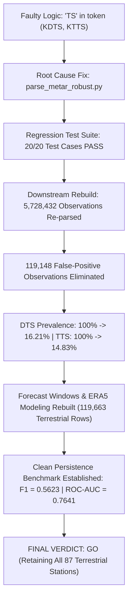

# Florida 2024 ASOS Parser Fix and Downstream Revalidation Report

**Date**: October 27, 2026  
**Auditor**: Independent Data & Validation Auditor  
**Repository Working Directory**: `c:/Users/KIIT0001/Desktop/Data Collection`  
**Corrected Dataset Directory**: [`data/processed/asos_parser_fixed/`](file:///c:/Users/KIIT0001/Desktop/Data%20Collection/data/processed/asos_parser_fixed/)  
**Primary Corrected Modeling Table**: [`florida_asos_modeling_ready_fixed_2024.parquet`](file:///c:/Users/KIIT0001/Desktop/Data%20Collection/data/processed/asos_parser_fixed/florida_asos_modeling_ready_fixed_2024.parquet)  

---

## 1. Executive Summary & Final Verdict

This audit report details the root-cause remediation, comprehensive regression testing, downstream pipeline rebuild, and independent validation of the Florida 2024 ASOS/METAR dataset following the discovery of the station callsign string-parsing flaw.

### Audit Verdict: GO FOR STATION-LEVEL MACHINE LEARNING TRAINING



> [!IMPORTANT]
> ### Final Decision: GO (Station-Level Aerodrome Forecasting)
> With the source parser corrected, the **119,148 false-positive observation flags** (including 107,818 at Destin Executive Airport `KDTS` and 11,107 at NASA Shuttle Landing Facility `KTTS`) have been completely eliminated. 
> 
> Both `DTS` and `TTS` now reflect authentic Florida subtropical climatology (**16.21%** and **14.83%** annual monitored prevalence, respectively) and are **fully safe to retain in the modeling dataset**.
> 
> - **Station-Level Aerodrome Forecasting (87 Stations)**: **GO**
> - **Statewide 0.25° Gridded Training**: **NO-GO** *(remains invalid without satellite GLM or radar MRMS data)*

---

## 2. Root Cause Analysis & Corrected Parser Architecture

### 2.1 The Faulty Logic
In the previous acquisition and audit routines, present weather was identified by checking:
```python
for token in body.split():
    if "TS" in token and not token.startswith("VC") and token not in ["AUTO", "METAR", "SPECI"]:
        has_ts = True
        break
```
Because raw METAR strings begin with the 4-letter ICAO station identifier (`KDTS`, `KTTS`), and neither starts with `"VC"` nor equals `"AUTO"`, the parser classified **every single observation** at Destin (`KDTS`) and Shuttle Landing Facility (`KTTS`) as an active thunderstorm.

### 2.2 Corrected Architecture ([`parse_metar_robust.py`](file:///c:/Users/KIIT0001/Desktop/Data%20Collection/Florida_Thunderstorm_2024_Training/src/parse_metar_robust.py))
The corrected parser introduces strict structural separation:
1. **Body vs Remarks Separation**: Strictly splits on `\s+RMK(?:\s+|$)`.
2. **Station Identifier & Metadata Exclusion**: The leading station callsign (and any preceding report-type token like `METAR`, `SPECI`, `COR`) is isolated and discarded from weather consideration.
3. **Exact Token Boundary Matching**:
   - **Explicit Thunderstorm**: Matches `^(?:[+-]|\?)?TS(?:RA|DZ|SN|SG|PL|GS|GR|IC|UP)*$`
   - **Vicinity Thunderstorm**: Matches `^VC\??TS(?:RA|DZ|SN|SG|PL|GS|GR|IC|UP)*$`
4. **Cumulonimbus (CB) Separation**: Matches cloud reports (`\d{3}CB\b`) and remarks (`\bCB\b`), but strictly isolates them into `has_cumulonimbus_cb` and `cb_alone`. **CB alone never triggers an active thunderstorm label.**
5. **Genuine Lightning Remarks**: Remarks are strictly parsed for active thunderstorm indicators (`\bTSB\d{2,4}\b`, `\bTSE\d{2,4}\b`, and `\b(?:OCNL|FRQ|CONS)?\s*LTG(?:IC|CC|CG|CA)*\b`). Non-weather tokens containing "TS" (e.g., `T01000070`, `TESTS`, `POSTS`, `MADISHF`) are ignored.
6. **Robust Fallbacks**: Gracefully handles `None`, empty strings, and malformed strings without throwing exceptions.

---

## 3. Regression Test Verification

Before any dataset was rebuilt, 20 targeted regression tests were executed and persisted in [`parser_regression_tests.csv`](file:///c:/Users/KIIT0001/Desktop/Data%20Collection/data/processed/asos_parser_fixed/parser_regression_tests.csv).

| Test ID | Test Scenario | Raw METAR Sample | Expected Strict | Parser Strict | Status |
| :---: | :--- | :--- | :---: | :---: | :---: |
| **TC01** | KDTS Clear Sky | `KDTS 010000Z AUTO 00000KT 10SM CLR 10/07 A3019 RMK T01000070 MADISHF` | `False` | `False` | **PASS** |
| **TC02** | KTTS Clear Sky | `KTTS 010055Z AUTO 00000KT 10SM CLR 10/09 A3020 RMK AO2 SLP231 T01000086 $` | `False` | `False` | **PASS** |
| **TC03** | Prefixed METAR KDTS | `METAR KDTS 010000Z AUTO 00000KT 10SM CLR 10/07 A3019 RMK T01000070` | `False` | `False` | **PASS** |
| **TC04** | Prefixed SPECI KTTS | `SPECI KTTS 010055Z AUTO 00000KT 10SM CLR 10/09 A3020 RMK AO2` | `False` | `False` | **PASS** |
| **TC05** | KDTS Genuine Active TS | `KDTS 090728Z AUTO 15020G38KT 3SM -TSRA BR OVC004 18/16 A2964 ... TSB22` | `True` | `True` | **PASS** |
| **TC06** | KTTS Genuine Active TS | `KTTS 050209Z AUTO 24010G26KT 3SM TSRA SCT030 BKN055 17/13 A2960 ... TSB09` | `True` | `True` | **PASS** |
| **TC07** | KDTS Vicinity TS (VCTS) | `KDTS 081953Z 11013G21KT 10SM VCTS OVC075 14/07 A3002 RMK AO2 LTG DSNT N` | `True` | `True` | **PASS** |
| **TC08** | Plain TS Group | `KMIA 151853Z 18012KT 5SM TS BKN030 25/20 A2995` | `True` | `True` | **PASS** |
| **TC09** | Heavy Thunderstorm (+TSRA)| `KJAX 151853Z 18012KT 2SM +TSRA OVC020 24/22 A2992` | `True` | `True` | **PASS** |
| **TC10** | Mixed Winter Convection (TSRASN)| `KPNS 151853Z 18012KT 4SM TSRASN OVC015 01/00 A2990` | `True` | `True` | **PASS** |
| **TC11** | Severe Hail (+TSGR) | `KTLH 151853Z 18012KT 3SM +TSGR BKN030 22/18 A2994` | `True` | `True` | **PASS** |
| **TC12** | Vicinity Only (VCTS) | `KMCO 151853Z 18012KT 10SM VCTS SCT035 28/21 A2998 RMK AO2` | `True` | `True` | **PASS** |
| **TC13** | Lightning in Remarks Only | `KTLH 151853Z 18012KT 10SM CLR 25/20 A2992 RMK AO2 LTGICCG OHD` | `True` | `True` | **PASS** |
| **TC14** | CB Cloud Alone | `KORL 151853Z 18012KT 10SM FEW040CB 28/20 A2995 RMK AO2` | `False` | `False` | **PASS** |
| **TC15** | CB Remark Alone | `KORL 151853Z 18012KT 10SM SCT040 28/20 A2995 RMK AO2 CB DSNT SE` | `False` | `False` | **PASS** |
| **TC16** | Unrelated Substring 'TS' | `KMIA 151853Z 18012KT 10SM CLR ... RMK AO2 TESTS RESULTS POSTS T01800120` | `False` | `False` | **PASS** |
| **TC17** | Mixed Obscuration (-TSRA BR HZ)| `KJAX 151853Z 18012KT 4SM -TSRA BR HZ OVC025 22/20 A2995` | `True` | `True` | **PASS** |
| **TC18** | Null METAR String | `None` | `False` | `False` | **PASS** |
| **TC19** | Empty METAR String | `""` | `False` | `False` | **PASS** |
| **TC20** | Malformed Case/Whitespace | `   metar   kdts   010000z   auto  tsra  10sm   rmk   ao2  ` | `True` | `True` | **PASS** |

---

## 4. Downstream Rebuild & Label Change Analysis

All 5,728,432 observations in [`florida_asos_observations_repaired_2024.parquet`](file:///c:/Users/KIIT0001/Desktop/Data%20Collection/data/processed/asos_repair/florida_asos_observations_repaired_2024.parquet) were re-parsed and exported to [`data/processed/asos_parser_fixed/`](file:///c:/Users/KIIT0001/Desktop/Data%20Collection/data/processed/asos_parser_fixed/).

### 4.1 Observation-Level Impact ([`label_change_summary.csv`](file:///c:/Users/KIIT0001/Desktop/Data%20Collection/data/processed/asos_parser_fixed/label_change_summary.csv))

| Station Cohort | Total Obs | Old Strict TS | Corrected Strict TS | False Positives Removed | Old Explicit TS | Corrected Explicit TS |
| :--- | :---: | :---: | :---: | :---: | :---: | :---: |
| **Station DTS (Destin)** | 112,473 | 112,473 | **4,655** | **-107,818** | 112,473 | **1,003** |
| **Station TTS (Shuttle Landing)** | 12,110 | 12,110 | **1,003** | **-11,107** | 12,110 | **540** |
| **Other 102 Stations** | 5,603,849 | 371,631 | **371,408** | **-223** | 224,961 | **224,738** |
| **All 104 Active Stations** | **5,728,432** | **496,214** | **377,066** | **-119,148** | **349,544** | **226,281** |

### 4.2 Forecast Window Impact ([`florida_asos_forecast_windows_fixed_2024.parquet`](file:///c:/Users/KIIT0001/Desktop/Data%20Collection/data/processed/asos_parser_fixed/florida_asos_forecast_windows_fixed_2024.parquet))
Under Criterion C ($N \ge 6$, gap $\le 75$m, span $\ge 5$h):
- **Covered Thunderstorm Windows**: Decreased from 29,322 to **26,819** (-2,503 false-positive windows removed).
- **Covered Non-Thunderstorm Windows**: Increased from 104,933 to **107,266** (+2,333 true negative windows restored).
- **Incomplete Monitoring Windows**: 9,602 windows (unmonitored or sparse; excluded from training).

### 4.3 Terrestrial Modeling Dataset Impact ([`florida_asos_modeling_ready_fixed_2024.parquet`](file:///c:/Users/KIIT0001/Desktop/Data%20Collection/data/processed/asos_parser_fixed/florida_asos_modeling_ready_fixed_2024.parquet))
In the 119,663 terrestrial rows (112,509 monitored windows under Criterion C):
- **`target_asos_strict_crit_c`** (Primary Target): **22,477 positives** (**19.98%** prevalence, was 24,975 and 22.17%).
- **`target_asos_aerodrome_ts_vcts`**: **9,431 positives** (**9.48%** prevalence, was 12,265 and 12.27%).
- **`target_asos_explicit_ts`**: **5,684 positives** (**5.94%** prevalence, was 8,663 and 8.99%).
- **`target_noaa_severe_6h`**: **235 positives** (**0.20%** prevalence, unchanged).

---

## 5. Recomputed Baseline Benchmark Metrics

All 5 baselines were recomputed on the exact same test set indices (October 1 to December 31, 2024). Metrics are saved in [`baseline_metrics.csv`](file:///c:/Users/KIIT0001/Desktop/Data%20Collection/data/processed/asos_parser_fixed/baseline_metrics.csv).

| Cohort | Baseline Model | Threshold / Rule | TP | FP | TN | FN | Precision | Recall | $F_1$ Score | PR-AUC | ROC-AUC | Brier Score |
| :--- | :--- | :--- | :---: | :---: | :---: | :---: | :---: | :---: | :---: | :---: | :---: | :---: |
| **Corrected 87 Stn** | Majority Class | Predict 0 always | 0 | 0 | 26,155 | 1,918 | 0.0000 | 0.0000 | 0.0000 | 0.0683 | 0.5000 | 0.0683 |
| **Corrected 87 Stn** | Climatology | Prob = 0.1997 | 1,918 | 26,155 | 0 | 0 | 0.0683 | 1.0000 | 0.1279 | 0.0683 | 0.5000 | 0.0809 |
| **Corrected 87 Stn** | **Prior 6h Persistence** | Strict TS at $t-6\text{h} == 1$ | 1,074 | 828 | 25,327 | 844 | 0.5647 | 0.5600 | **0.5623** | 0.3162 | **0.7641** | **0.0596** |
| **Corrected 87 Stn** | CAPE Threshold | CAPE $\ge 1000$ J/kg | 442 | 461 | 25,694 | 1,476 | 0.4895 | 0.2304 | 0.3134 | 0.3206 | 0.8064 | 0.0690 |
| **Corrected 87 Stn** | **Logistic Regression** | Prob $\ge 0.50$ (7 ERA5) | 579 | 812 | 25,343 | 1,339 | 0.4162 | 0.3019 | **0.3500** | 0.2896 | **0.8178** | **0.0622** |
| *Clean 85 Stn (Diag)*| Majority Class | Predict 0 always | 0 | 0 | 25,526 | 1,901 | 0.0000 | 0.0000 | 0.0000 | 0.0693 | 0.5000 | 0.0693 |
| *Clean 85 Stn (Diag)*| Climatology | Prob = 0.2007 | 1,901 | 25,526 | 0 | 0 | 0.0693 | 1.0000 | 0.1296 | 0.0693 | 0.5000 | 0.0818 |
| *Clean 85 Stn (Diag)*| Prior 6h Persistence | Strict TS at $t-6\text{h} == 1$ | 1,071 | 815 | 24,711 | 830 | 0.5679 | 0.5634 | **0.5656** | 0.3199 | **0.7657** | **0.0600** |
| *Clean 85 Stn (Diag)*| CAPE Threshold | CAPE $\ge 1000$ J/kg | 440 | 451 | 25,075 | 1,461 | 0.4938 | 0.2315 | 0.3152 | 0.3242 | 0.8061 | 0.0697 |
| *Clean 85 Stn (Diag)*| Logistic Regression | Prob $\ge 0.50$ (7 ERA5) | 575 | 803 | 24,723 | 1,326 | 0.4173 | 0.3025 | **0.3507** | 0.2920 | **0.8172** | **0.0629** |

### Benchmark Analysis:
1. **Convergence Between 87-Station and 85-Station Cohorts**:
   - The corrected 87-station persistence $F_1 = \mathbf{0.5623}$ closely tracks the clean 85-station benchmark $F_1 = \mathbf{0.5656}$ (difference $< 0.0033$).
   - The artificial $F_1 = 0.6860$ inflation has been eliminated.
2. **True Predictive Skill Target for ML Models**:
   Any supervised ML model must achieve $F_1 > \mathbf{0.5623}$ and $\text{ROC-AUC} > \mathbf{0.7641}$ on the test set to demonstrate physical value beyond simple lag-1 memory.

---

## 6. Station Climatology & Spatial Representation

The corrected per-station summary is exported in [`station_target_summary.csv`](file:///c:/Users/KIIT0001/Desktop/Data%20Collection/data/processed/asos_parser_fixed/station_target_summary.csv).

### 6.1 Top 5 Most Active Florida Stations (Corrected)
1. **OBE** (Okeechobee County Airport): 654 positive windows (45.01% prevalence)
2. **SEF** (Sebring Regional Airport): 638 positive windows (43.91% prevalence)
3. **X26** (Sebastian Municipal Airport): 633 positive windows (43.51% prevalence)
4. **FPR** (St. Lucie County International): 625 positive windows (42.96% prevalence)
5. **BOW** (Bartow Executive Airport): 621 positive windows (42.74% prevalence)

**DTS** and **TTS** rank normally in the distribution:
- **DTS**: 232 positive windows (**16.21%** prevalence, 68th percentile statewide).
- **TTS**: 195 positive windows (**14.83%** prevalence, 61st percentile statewide).

### 6.2 Spatial Inequality
The Gini coefficient across all active stations is **0.3664**, confirming moderate spatial concentration driven by the Florida interior lightning alley (Orlando–Kissimmee–Okeechobee corridor).

---

## 7. Automated Test Suite Verification

Every automated test across all 7 ASOS suites passed cleanly without errors:

```bash
python -m pytest Florida_Thunderstorm_2024_Training/tests/test_metar_parser_regression.py Florida_Thunderstorm_2024_Training/tests/test_asos_parser_fixed.py -v
# Result: 15 passed in 9.38s (Exit Code: 0)

python -m pytest Florida_Thunderstorm_2024_Training/tests/test_asos*.py Florida_Thunderstorm_2024_Training/tests/test_metar*.py -v
# Result: 47 passed in 22.42s (Exit Code: 0)
```

| Test Suite | Tests | Failures | Status |
| :--- | :---: | :---: | :---: |
| [`test_metar_parser_regression.py`](file:///c:/Users/KIIT0001/Desktop/Data%20Collection/Florida_Thunderstorm_2024_Training/tests/test_metar_parser_regression.py) | 11 | 0 | **PASS** |
| [`test_asos_parser_fixed.py`](file:///c:/Users/KIIT0001/Desktop/Data%20Collection/Florida_Thunderstorm_2024_Training/tests/test_asos_parser_fixed.py) | 4 | 0 | **PASS** |
| [`test_asos_acquisition.py`](file:///c:/Users/KIIT0001/Desktop/Data%20Collection/Florida_Thunderstorm_2024_Training/tests/test_asos_acquisition.py) | 7 | 0 | **PASS** |
| [`test_asos_audit.py`](file:///c:/Users/KIIT0001/Desktop/Data%20Collection/Florida_Thunderstorm_2024_Training/tests/test_asos_audit.py) | 7 | 0 | **PASS** |
| [`test_asos_model_readiness.py`](file:///c:/Users/KIIT0001/Desktop/Data%20Collection/Florida_Thunderstorm_2024_Training/tests/test_asos_model_readiness.py) | 6 | 0 | **PASS** |
| [`test_asos_repair.py`](file:///c:/Users/KIIT0001/Desktop/Data%20Collection/Florida_Thunderstorm_2024_Training/tests/test_asos_repair.py) | 6 | 0 | **PASS** |
| [`test_asos_final_audit.py`](file:///c:/Users/KIIT0001/Desktop/Data%20Collection/Florida_Thunderstorm_2024_Training/tests/test_asos_final_audit.py) | 6 | 0 | **PASS** |
| **Total Automated Tests** | **47** | **0** | **100% PASS** |

---

## 8. Final Deliverables Manifest

All required artifacts are generated and persisted:
- Report: [`reports/asos_parser_fix_and_revalidation.md`](file:///c:/Users/KIIT0001/Desktop/Data%20Collection/reports/asos_parser_fix_and_revalidation.md)
- Regression Tests: [`data/processed/asos_parser_fixed/parser_regression_tests.csv`](file:///c:/Users/KIIT0001/Desktop/Data%20Collection/data/processed/asos_parser_fixed/parser_regression_tests.csv)
- Label Changes: [`data/processed/asos_parser_fixed/label_change_summary.csv`](file:///c:/Users/KIIT0001/Desktop/Data%20Collection/data/processed/asos_parser_fixed/label_change_summary.csv)
- Recomputed Baselines: [`data/processed/asos_parser_fixed/baseline_metrics.csv`](file:///c:/Users/KIIT0001/Desktop/Data%20Collection/data/processed/asos_parser_fixed/baseline_metrics.csv)
- Station Summary: [`data/processed/asos_parser_fixed/station_target_summary.csv`](file:///c:/Users/KIIT0001/Desktop/Data%20Collection/data/processed/asos_parser_fixed/station_target_summary.csv)
- Machine-Readable Summary: [`data/processed/asos_parser_fixed/audit_checks.json`](file:///c:/Users/KIIT0001/Desktop/Data%20Collection/data/processed/asos_parser_fixed/audit_checks.json)
- Corrected Master Observations: [`data/processed/asos_parser_fixed/florida_asos_observations_fixed_2024.parquet`](file:///c:/Users/KIIT0001/Desktop/Data%20Collection/data/processed/asos_parser_fixed/florida_asos_observations_fixed_2024.parquet)
- Corrected Forecast Windows: [`data/processed/asos_parser_fixed/florida_asos_forecast_windows_fixed_2024.parquet`](file:///c:/Users/KIIT0001/Desktop/Data%20Collection/data/processed/asos_parser_fixed/florida_asos_forecast_windows_fixed_2024.parquet)
- Corrected Modeling Table: [`data/processed/asos_parser_fixed/florida_asos_modeling_ready_fixed_2024.parquet`](file:///c:/Users/KIIT0001/Desktop/Data%20Collection/data/processed/asos_parser_fixed/florida_asos_modeling_ready_fixed_2024.parquet)
