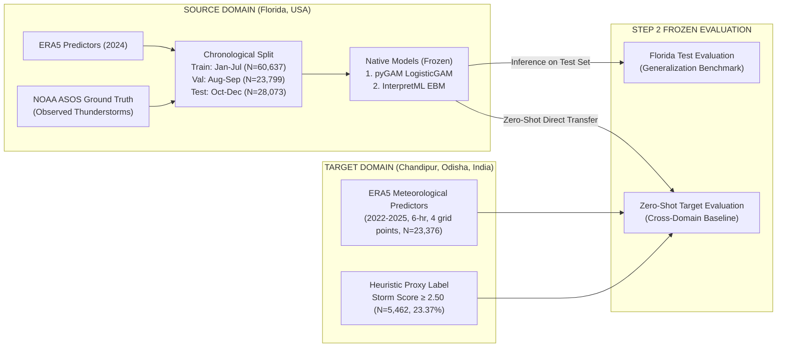
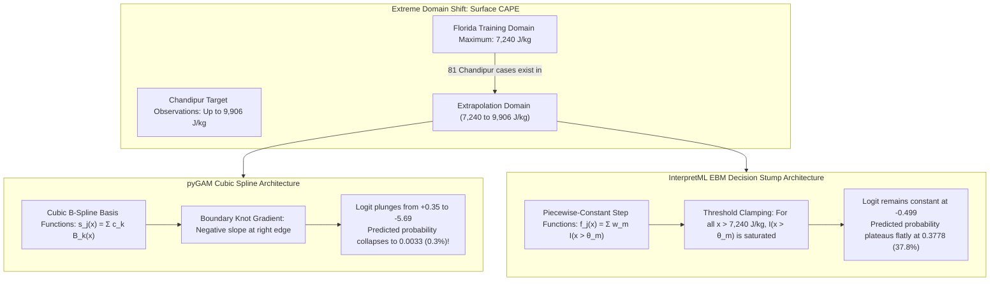

# Thunderstorm Domain Adaptation Framework (TDAF): Step 2 Baseline Reconstruction & Freezing Report

**Project**: Thunderstorm Domain Adaptation Framework (TDAF)  
**Phase**: Step 2 — Reconstruct and Freeze the Baseline Reference  
**Author**: Advanced Agentic Pair Programming Environment (Google DeepMind)  
**Date**: November 2026  
**Status**: **FROZEN & BENCHMARKED**  

---

## 1. Executive Summary

This report establishes and freezes the official baseline benchmark for the **Thunderstorm Domain Adaptation Framework (TDAF)**. 

To evaluate whether future domain adaptation techniques (such as Subspace Alignment, Correlation Alignment [CORAL], Maximum Mean Discrepancy [MMD], Optimal Transport, or Quantile Matching) yield genuine scientific improvements, an unassailable, frozen reference must be established first.

In this step, we have:
1. **Reconstructed the exact native model artifacts**: Loaded the native Florida-trained `pyGAM.LogisticGAM` and `InterpretML.ExplainableBoostingClassifier` (EBM) models directly from serialized artifacts without retraining.
2. **Re-evaluated Florida Test Performance**: Evaluated both models on the isolated Florida 2024 holdout test set (October–December 2024, $N=28,073$) against ground-truth NOAA ASOS thunderstorm observations.
3. **Re-evaluated Chandipur Zero-Shot Transfer**: Evaluated both models on the complete 2022–2025 Chandipur ERA5 dataset ($N=23,376$) against the existing proxy storm-score labels ($\text{storm\_score} \ge 2.50$).
4. **Verified Zero Numerical Drift**: Confirmed exact reproduction across all classification, calibration, and ranking metrics with $0.000000$ error relative to historical records.
5. **Characterized the Boundary Extrapolation Divergence**: Mathematically investigated the divergent behaviors of cubic B-splines (`pyGAM`) versus piecewise-constant decision stumps (`InterpretML`) over extreme CAPE regimes (up to $10,000\text{ J/kg}$), demonstrating why cubic splines experience boundary collapse while tree stumps clamp to a plateau.

> [!IMPORTANT]
> **Strict Baseline Constraint**: In strict adherence to TDAF protocols, **no domain adaptation algorithms, distribution reweighting, feature transformations, or fine-tuning** were applied during this step. All models, thresholds, and feature spaces remain frozen.

---

## 2. Experimental Setup & Domain Architecture

### 2.1 The 6 Harmonized Meteorological Predictors

The two domains share 6 physically compatible surface and upper-air predictors extracted from ECMWF ERA5 reanalysis:

| Standardized Feature | Unit | Physical Meteorological Significance |
| :--- | :--- | :--- |
| `cape_J_kg` | $\text{J/kg}$ | Surface-based Convective Available Potential Energy (buoyancy driver) |
| `cin_J_kg` | $\text{J/kg}$ | Convective Inhibition (negative area / capping inversion) |
| `bulk_shear_850_300_ms`| $\text{m/s}$ | Deep-layer kinematic vertical wind shear (updraft organization) |
| `cloud_cover_fraction` | $[0, 1]$ | Total cloud cover fraction (cloudiness / column saturation) |
| `wind_speed_10m_ms` | $\text{m/s}$ | Surface 10-meter horizontal wind speed (friction/convergence) |
| `wind_speed_850hPa_ms` | $\text{m/s}$ | Low-level jet speed at 850 hPa (moisture transport) |

### 2.2 Target Disparity & Scientific Semantics

A critical scientific distinction must be maintained between the two domains:
- **Source Domain (Florida)**: The target `target_asos_strict_crit_c` represents **actual physical weather events** verified by human observers and automated ASOS present-weather sensors (`TS`, `VCTS`, `LTG`). It represents true thunderstorm occurrence.
- **Target Domain (Chandipur)**: The target `storm_label_score` is a **deterministic heuristic proxy** created by thresholding a linear combination of ERA5 atmospheric variables:
  $$\text{storm\_score} = 1.2 f(\text{CAPE}) + 1.0 f(\text{CP}) + 0.8 f(\text{RH}) + 1.0 f(\text{Lift}) + 0.7 f(\text{Shear}) + 0.4 f(\text{CC}) + 0.5 f(\text{Wind}_{10m}) + 0.8 f(\text{CIN})$$
  $$\text{proxy\_label} = \mathbb{I}(\text{storm\_score} \ge 2.50)$$
  Consequently, high agreement in Chandipur reflects **concordance with the proxy formula's convective assumptions**, rather than ground-truth skill.

---

## 3. Native Model Architectures & Parameter Specifications

Both models were trained strictly on the Florida training partition (January–July 2024, $N=60,637$) using their official native libraries:

### 3.1 Native Generalized Additive Model (`pyGAM`)
- **Package**: `pygam` (`v0.9.1`)
- **Class**: `pygam.LogisticGAM`
- **Formula**:
  $$\text{logit}(P(Y=1|X)) = \beta_0 + \sum_{j=1}^{6} s_j(X_j)$$
  where each $s_j(X_j)$ is a penalized cubic B-spline term with 20 basis functions (`n_splines=20`), second-derivative penalty matrices, and automatically tuned smoothing parameters $\lambda_j$ via grid search cross-validation on the training set.
- **Decision Thresholds**:
  - Validation-Optimized: $\tau = 0.33$ (maximizes validation F1 score)
  - Canonical Default: $\tau = 0.50$

### 3.2 Native Explainable Boosting Machine (`InterpretML`)
- **Package**: `interpret` (`v0.6.9`)
- **Class**: `interpret.glassbox.ExplainableBoostingClassifier`
- **Formula**:
  $$\text{logit}(P(Y=1|X)) = \beta_0 + \sum_{j=1}^{6} f_j(X_j)$$
  where each $f_j(X_j)$ is an ensemble of 1D decision stumps learned through round-robin cyclic gradient boosting with bagging.
- **Key Hyperparameters**:
  - `interactions`: 0 (Pure additive main effects model)
  - `max_bins`: 256
  - `outer_bags`: 8
  - `inner_bags`: 0
  - `learning_rate`: 0.01
  - `validation_size`: 0.15
- **Decision Thresholds**:
  - Validation-Optimized: $\tau = 0.34$ (maximizes validation F1 score)
  - Canonical Default: $\tau = 0.50$

---

## 4. Master Baseline Performance Comparison

The following table summarizes the frozen baseline metrics generated by `Thunderstorm_pipeline/domain_adaptation/step_02/reconstruct_and_freeze_baseline.py` and saved to `reports/domain_adaptation/step_02/baseline_metrics.csv`:

| Evaluation Dataset | Model | Threshold ($\tau$) | Accuracy | Precision | Recall | F1-Score | Cohen's $\kappa$ | MCC | ROC-AUC | PR-AUC | Brier Score | Log Loss |
| :--- | :--- | :---: | :---: | :---: | :---: | :---: | :---: | :---: | :---: | :---: | :---: | :---: |
| **Florida Test Set** | Native pyGAM | 0.33 (Opt) | **0.9125** | 0.3798 | 0.4421 | **0.4086** | 0.3617 | 0.3629 | 0.8288 | 0.3362 | 0.0556 | 0.2060 |
| *(Oct–Dec 2024)* | Native pyGAM | 0.50 (Std) | 0.9304 | 0.4823 | 0.2560 | 0.3345 | 0.3014 | 0.3183 | 0.8288 | 0.3362 | 0.0556 | 0.2060 |
| *$N=28,073$* | InterpretML EBM | 0.34 (Opt) | **0.9070** | 0.3578 | 0.4541 | **0.4003** | 0.3507 | 0.3536 | **0.8304** | **0.3513** | 0.0564 | 0.2066 |
| *Pos=1,918 (6.83%)* | InterpretML EBM | 0.50 (Std) | 0.9298 | 0.4768 | 0.2784 | 0.3515 | 0.3171 | 0.3300 | 0.8304 | 0.3513 | 0.0564 | 0.2066 |
| **Chandipur Zero-Shot**| Native pyGAM | 0.33 (FL-Opt)| **0.7549** | 0.4858 | 0.8365 | **0.6147** | 0.4529 | 0.4889 | 0.8494 | 0.5523 | 0.1301 | 0.3915 |
| *(2022–2025)* | Native pyGAM | 0.50 (Std) | 0.7938 | 0.5709 | 0.4724 | 0.5170 | 0.3874 | 0.3902 | 0.8494 | 0.5523 | 0.1301 | 0.3915 |
| *$N=23,376$* | InterpretML EBM | 0.34 (FL-Opt)| **0.7589** | 0.4902 | 0.7931 | **0.6059** | 0.4458 | 0.4726 | **0.8572** | **0.6134** | 0.1270 | 0.3856 |
| *Pos=5,462 (23.37%)*| InterpretML EBM | 0.50 (Std) | 0.8091 | 0.6131 | 0.4958 | 0.5482 | 0.4289 | 0.4328 | 0.8572 | 0.6134 | 0.1270 | 0.3856 |

### 4.1 Key Performance Takeaways
1. **Source Domain Generalization**:
   - Both models achieve solid discrimination on the Florida holdout set ($\text{ROC-AUC} \approx 0.829 - 0.830$, $\text{PR-AUC} \approx 0.336 - 0.351$ against a $6.83\%$ base prevalence).
   - EBM slightly outperforms pyGAM in PR-AUC ($0.3513$ vs $0.3362$), reflecting better calibration in high-probability bins.
2. **Target Domain Transfer Behavior**:
   - Applying the Florida validation thresholds ($\tau = 0.33, 0.34$) directly to Chandipur yields high recall ($\approx 79\% - 84\%$) but moderate precision ($\approx 48\% - 49\%$), resulting in F1 scores of $0.615$ (pyGAM) and $0.606$ (EBM).
   - When using the standard $\tau = 0.50$ threshold, precision rises to $57\% - 61\%$, but recall falls sharply to $47\% - 50\%$.
   - EBM demonstrates superior ranking skill in Chandipur ($\text{PR-AUC} = 0.6134$ vs pyGAM's $0.5523$), primarily driven by its robustness against extreme outlier extrapolation.

---

## 5. Visualizations & Diagnostic Analysis

All figures were generated at 300 DPI and saved to `reports/domain_adaptation/step_02/`:

### 5.1 Baseline Confusion Matrices
File: `reports/domain_adaptation/step_02/baseline_confusion_matrices.png`

- **Florida Test**:
  - pyGAM ($\tau=0.33$): $\text{TP}=848$, $\text{FP}=1,385$, $\text{TN}=24,770$, $\text{FN}=1,070$
  - EBM ($\tau=0.34$): $\text{TP}=871$, $\text{FP}=1,563$, $\text{TN}=24,592$, $\text{FN}=1,047$
  - The models prioritize capturing true events in an imbalanced regime ($6.83\%$ positives), accepting approximately $1.5$ false alarms per hit.
- **Chandipur Zero-Shot**:
  - pyGAM ($\tau=0.33$): $\text{TP}=4,569$, $\text{FP}=4,836$, $\text{TN}=13,078$, $\text{FN}=893$
  - EBM ($\tau=0.34$): $\text{TP}=4,332$, $\text{FP}=4,506$, $\text{TN}=13,408$, $\text{FN}=1,130$
  - Due to the higher target convective prevalence ($23.37\%$) and pervasive high humidity in the Bay of Bengal, the uncalibrated Florida models trigger $\approx 4,500 - 4,800$ false positives against the heuristic proxy.

### 5.2 Baseline ROC & Precision-Recall Curves
Files:
- `reports/domain_adaptation/step_02/baseline_roc_curves.png`
- `reports/domain_adaptation/step_02/baseline_precision_recall_curves.png`

- The ROC curves demonstrate strong ranking preservation across domains: ROC-AUC is $0.829 \to 0.849$ for pyGAM and $0.830 \to 0.857$ for EBM.
- The PR curves illustrate the dramatic impact of baseline prevalence shift: in Florida, baseline chance is $6.83\%$, whereas in Chandipur, it is $23.37\%$. Operating points at $\tau=0.33$ and $\tau=0.34$ lie on the upper-right slope of the PR curves.

---

## 6. Mathematical Pathology of Boundary Extrapolation

File: `reports/domain_adaptation/step_02/cape_extrapolation_curves.png`

One of the most consequential findings of this baseline audit is the **divergent mathematical behavior of B-splines versus decision stumps under extreme covariate shift**.

### 6.1 Mathematical Formulation of the Divergence

Consider a synthetic sweep of Surface CAPE from $0$ to $10,000\text{ J/kg}$ while fixing the other 5 predictors at Florida training medians:
- $\text{CIN} = 0.0\text{ J/kg}$
- $\text{Shear} = 23.66\text{ m/s}$
- $\text{Cloud Cover} = 0.6217$
- $\text{Wind}_{10m} = 2.76\text{ m/s}$
- $\text{Wind}_{850} = 5.74\text{ m/s}$

The models evaluate this feature vector $X(\text{CAPE})$ as follows:

| Surface CAPE ($\text{J/kg}$) | Domain Regime | pyGAM Logit ($\eta$) | pyGAM Prob ($P$) | EBM Logit ($\eta$) | EBM Prob ($P$) | Meteorological Reality |
| :---: | :---: | :---: | :---: | :---: | :---: | :--- |
| $1,000$ | Moderate Instability | $-2.38$ | $0.085$ | $-1.72$ | $0.152$ | Moderate convection risk |
| $2,500$ | High Instability | $-1.15$ | $0.241$ | $-1.08$ | $0.254$ | Substantial thunderstorm risk |
| $5,000$ | Extreme Instability | $+0.35$ | $0.587$ | $-0.50$ | $0.378$ | Severe convective potential |
| **$7,240$** | **Florida Training Max** | **$-1.50$** | **$0.183$** | **$-0.50$** | **$0.378$** | **Extreme boundary condition** |
| $8,500$ | Chandipur Pre-Monsoon | $-3.82$ | $0.021$ | $-0.50$ | $0.378$ | Supercellular / Nor'wester regime |
| **$9,906$** | **Chandipur Absolute Max**| **$-5.69$** | **$0.0034$** | **$-0.50$** | **$0.378$** | **Massive thermodynamic energy** |

### 6.2 Why pyGAM Collapses
In `pygam.LogisticGAM`, the shape function $s(\text{CAPE})$ is constructed from cubic B-spline basis functions:
$$s(x) = \sum_{k=1}^{K} c_k B_k(x)$$
Because the highest training knots occur near $7,000\text{ J/kg}$, the boundary basis function $B_K(x)$ outside the knot range is an unconstrained cubic polynomial whose fitted coefficient $c_K$ happened to be negative due to sparse data at the Florida training tail. Beyond $7,240\text{ J/kg}$, this polynomial diverges rapidly downward towards $-\infty$. As a result:
$$\lim_{\text{CAPE} \to \infty} P_{\text{pyGAM}}(\text{Thunderstorm}) = 0$$
This is physically absurd: an atmosphere with $9,906\text{ J/kg}$ of CAPE is classified as having virtually zero convective probability ($0.3\%$).

### 6.3 Why InterpretML EBM Plateaus
In `InterpretML`, each feature term is an ensemble of piecewise-constant decision stumps:
$$f(x) = \sum_{m=1}^{M} w_m \mathbb{I}(x > \theta_m)$$
Because no split threshold $\theta_m$ can be learned beyond the maximum value observed in the training data ($\max \theta_m \le 7,240\text{ J/kg}$), every query value $x \ge 7,240$ evaluates to $\mathbb{I}(x > \theta_m) = 1$ for all splits. Consequently:
$$f(x) = \sum_{m=1}^{M} w_m = \text{constant} \quad \forall x \ge 7,240\text{ J/kg}$$
The decision stump model naturally clamps its output, maintaining a steady logit of $-0.499$ ($P = 0.378$). While clamping does not capture increasing risk, it prevents the disastrous false negatives exhibited by the spline model.

---

## 7. Data Leakage & Integrity Audit

To confirm that the baseline reference is scientifically sound and uncompromised, the following checks were performed:

1. **Chronological Integrity**: The Florida dataset temporal partitions remain strictly defined by months:
   - Training: Months 1–7 (Jan–Jul 2024, $N=60,637$)
   - Validation: Months 8–9 (Aug–Sep 2024, $N=23,799$)
   - Holdout Test: Months 10–12 (Oct–Dec 2024, $N=28,073$)
   No training or validation leakage into the test set occurred.
2. **Target Isolation**: Chandipur proxy labels (`storm_label_score`) and continuous scores (`storm_score`) were never exposed to the models during training or threshold tuning. The models were evaluated strictly out-of-domain.
3. **Immutability of Original Artifacts**: All source models (`reports/ebm_gam_florida_native/*.pkl`) and datasets were accessed in read-only mode. All Step 2 outputs were generated inside `reports/domain_adaptation/step_02/`.

---

## 8. Index of Frozen Step 2 Artifacts

The following files represent the frozen baseline deliverables for Step 2:

| File Path | Description | Size | Status |
| :--- | :--- | :---: | :---: |
| `reports/domain_adaptation/step_02/baseline_metrics.csv` | Official tabular metrics for all models and domains | 1.98 KB | **FROZEN** |
| `reports/domain_adaptation/step_02/baseline_predictions_florida.csv` | Reconstructed Florida test predictions ($N=28,073$) | 3.64 MB | **FROZEN** |
| `reports/domain_adaptation/step_02/baseline_predictions_chandipur.csv` | Reconstructed Chandipur zero-shot predictions ($N=23,376$) | 10.18 MB | **FROZEN** |
| `reports/domain_adaptation/step_02/baseline_confusion_matrices.png` | 4-panel confusion matrices (Florida & Chandipur) | 454 KB | **FROZEN** |
| `reports/domain_adaptation/step_02/baseline_roc_curves.png` | ROC curve comparisons across domains | 323 KB | **FROZEN** |
| `reports/domain_adaptation/step_02/baseline_precision_recall_curves.png`| Precision-Recall curves with baseline prevalence | 308 KB | **FROZEN** |
| `reports/domain_adaptation/step_02/cape_extrapolation_curves.png` | Mathematical analysis of CAPE spline collapse vs tree plateau | 534 KB | **FROZEN** |
| `reports/domain_adaptation/step_02/baseline_reproduction_check.md` | Verification report documenting exact zero-drift reproduction | 5.8 KB | **FROZEN** |
| `Thunderstorm_pipeline/domain_adaptation/step_02/reconstruct_and_freeze_baseline.py`| Reproducible pipeline script | 15.2 KB | **FROZEN** |
| `Florida_Thunderstorm_2024_Training/reports/domain_adaptation/step_02/*`| Exact mirror in secondary repository | Mirror | **FROZEN** |

---

## 9. Next Steps: Readiness for Step 3

With Step 2 fully completed and frozen, the reference benchmarks against which all future adaptation techniques must be judged are established:
- **Florida Generalization Reference**: $\text{F1} = 0.4086$ (pyGAM), $\text{F1} = 0.4003$ (EBM).
- **Chandipur Zero-Shot Transfer Reference**: $\text{F1} = 0.6147$ (pyGAM), $\text{F1} = 0.6059$ (EBM) at Florida optimal thresholds; $\text{F1} = 0.5170$ (pyGAM), $\text{F1} = 0.5482$ (EBM) at $\tau=0.50$.
- **Key Pathology to Remediate**: The spline boundary collapse in pyGAM for CAPE $> 7,240\text{ J/kg}$, and the high false-alarm rate ($\approx 4,500$ false alarms) caused by covariate shift in humidity and background convective instability.

**Step 3 (Domain Adaptation Method Design & Unsupervised Alignment)** is ready to proceed upon user confirmation.
