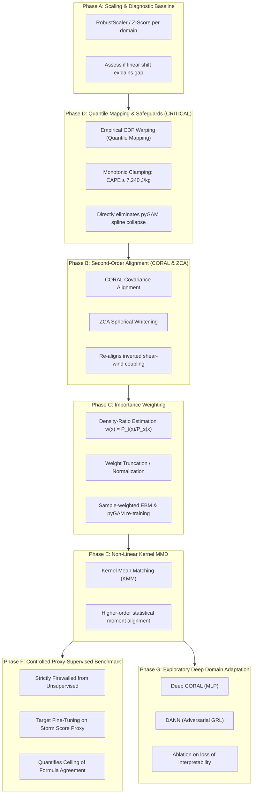

# TDAF Recommended Domain Adaptation Experiment Roadmap

**Framework**: Thunderstorm Domain Adaptation Framework (TDAF)  
**Phase**: Step 3 Strategy Design  
**Date**: November 2026  
**Status**: **PROPOSED & STAGED FOR EXECUTION**  

---

## 1. Guiding Scientific Principles

All adaptation experiments in this framework adhere to six non-negotiable principles:
1. **Glassbox Interpretability Preservation**: The primary objective is to maintain the native explainability of `pyGAM` and `InterpretML` EBM. Black-box methods (e.g. Deep CORAL, DANN) are relegated to exploratory reference benchmarks.
2. **Unsupervised Primary Track**: Primary adaptation must operate without access to target labels $Y_{\text{target}}$. The target domain is treated as unannotated.
3. **Strict Target-Label Firewall**: Any experiment utilizing Chandipur proxy labels (`storm_label_score`) must be strictly segregated into Phase F and explicitly designated as *proxy-supervised calibration*, not real-world ground-truth transfer.
4. **Frozen Reference Benchmark**: Every adapted model will be evaluated against the frozen Step 2 baselines:
   - Florida Test: pyGAM F1 = $0.4086$, EBM F1 = $0.4003$
   - Chandipur Zero-Shot: pyGAM F1 = $0.6147$ ($\tau=0.33$), EBM F1 = $0.6059$ ($\tau=0.34$); pyGAM F1 = $0.5170$ ($\tau=0.50$), EBM F1 = $0.5482$ ($\tau=0.50$).
5. **No Test-Label Threshold Tuning**: In unsupervised phases, decision thresholds must be derived from source validation or unsupervised criteria (e.g., target prevalence matching), never by maximizing F1 against Chandipur proxy labels.
6. **Physical Bound Safeguards**: All pipelines must enforce boundary safeguards to prevent mathematical extrapolation pathologies (such as pyGAM spline collapse for $\text{CAPE} > 7,240\text{ J/kg}$).

---

## 2. Staged Experimental Phases

---

### Phase A: Feature Scaling and Normalization Diagnostics
- **Objective**: Establish whether simple marginal scale and location shifts account for performance degradation.
- **Input Data**: Florida training partition ($N=60,637$) and Chandipur unlabelled features ($N=23,376$).
- **Methodology**:
  - Independent domain Z-scoring: $Z_S = (X_S - \mu_S)/\sigma_S$, $Z_T = (X_T - \mu_T)/\sigma_T$.
  - Domain-specific RobustScaler using medians and IQRs to withstand heavy tropical CAPE/CIN tails.
- **Target Labels Used**: **No** (Strictly Unsupervised).
- **Expected Benefit**: Mitigates linear offset in wind speeds and deep shear.
- **Main Scientific Risk**: Fails to resolve non-linear tail divergence in CAPE ($>7,240\text{ J/kg}$) or opposing cross-correlations ($\Delta R = -0.51$).
- **Evaluation Metrics**: ROC-AUC, PR-AUC, F1 at canonical threshold $\tau=0.50$, Wasserstein distance reduction.
- **Acceptance Criteria**: Reduction in mean Wasserstein distance $> 30\%$ without degrading Florida test calibration.

---

### Phase D: Quantile Mapping & Extrapolation Safeguards *(Recommended Priority 1)*
- **Objective**: Remediate the pyGAM spline collapse and map extreme out-of-distribution Chandipur thermodynamic variables onto the supported Florida knot domain.
- **Input Data**: Source training features and target unlabelled features.
- **Methodology**:
  - Univariate Empirical Quantile Mapping:
    $$\tilde{X}_T^{(j)} = F_{S, j}^{-1}\left(F_{T, j}(X_T^{(j)})\right)$$
  - Monotonic Boundary Clamping: Strictly cap $\text{CAPE} \le 7,240\text{ J/kg}$ and $\text{CIN} \le 997\text{ J/kg}$ prior to evaluating frozen models.
- **Target Labels Used**: **No** (Strictly Unsupervised).
- **Expected Benefit**: Directly recovers the $81$ extreme pre-monsoon cases where pyGAM previously collapsed to $0.003$ probability; prevents boundary divergence while preserving feature rankings.
- **Main Scientific Risk**: Compresses physical tail distinctions into upper training percentiles.
- **Evaluation Metrics**: F1 score on extreme CAPE subset, global PR-AUC, Brier score, calibration curve slope.
- **Acceptance Criteria**: Elimination of zero-probability predictions for $\text{CAPE} > 7,240\text{ J/kg}$; improvement in pyGAM target PR-AUC from $0.5523$ to $> 0.5900$.

---

### Phase B: Second-Order Moment Alignment (CORAL and ZCA)
- **Objective**: Align the empirical covariance matrices to reconcile the dramatic correlation inversions (e.g. shear-vs-wind correlation $\Delta R = -0.507$, CAPE-vs-wind $\Delta R = +0.488$).
- **Input Data**: Florida training feature matrix $X_S$ ($60,637 \times 6$) and Chandipur feature matrix $X_T$ ($23,376 \times 6$).
- **Methodology**:
  - Standard CORAL: Compute covariance matrices $C_S$ and $C_T$. Apply linear transformation $A = C_S^{+1/2} C_T^{-1/2}$ to target features:
    $$X_{T, \text{coral}} = (X_T - \mu_T) A + \mu_S$$
  - ZCA Whitening Variant: Spherical decorrelation of both domains into a shared isotropic basis.
- **Target Labels Used**: **No** (Strictly Unsupervised).
- **Expected Benefit**: Synchronizes multivariate kinematic-thermodynamic coupling across domains.
- **Main Scientific Risk**: Linear rotation mixes physical features (e.g. CAPE mixed with Shear), slightly diluting univariate spline interpretability unless mapped back.
- **Evaluation Metrics**: Covariance Frobenius distance $||C_{T, \text{adapted}} - C_S||_F$, domain classifier separability reduction (LightGBM AUC drop from $0.863$ toward $0.500$), F1 score.
- **Acceptance Criteria**: Reduction in covariance Frobenius distance by $> 75\%$; domain classifier AUC $\le 0.650$.

---

### Phase C: Density-Ratio Importance Weighting
- **Objective**: Re-weight Florida source training observations so that the training distribution matches the Chandipur target density: $w(x) = P_T(x) / P_S(x)$.
- **Input Data**: Source training pairs $(X_S, Y_S)$ and target unlabelled features $X_T$.
- **Methodology**:
  - Probabilistic Classifier-Based Weighting: Train a domain discriminator to output $d(x) = P(\text{Domain}=T|x)$, yielding weights:
    $$w(x) = \frac{d(x)}{1 - d(x)} \cdot \frac{N_S}{N_T}$$
  - Weight Stabilization: Apply weight clipping at the 95th percentile ($w_{\max} = 10.0$) to avoid gradient explosion on rare high-CAPE Florida events.
  - Re-train `InterpretML` EBM using `sample_weight=w` and `pyGAM` using weighted iterative penalized B-spline estimation.
- **Target Labels Used**: **No** (Strictly Unsupervised).
- **Expected Benefit**: Focuses source model capacity on atmospheric states typical of the Bay of Bengal (e.g. high ambient humidity and moderate shear).
- **Main Scientific Risk**: High weight variance on under-represented boundary states.
- **Evaluation Metrics**: Target PR-AUC, Effective Sample Size (ESS), Brier score.
- **Acceptance Criteria**: $\text{ESS} > 0.20 \times N_S$; improvement in target calibration slope without degrading Florida test ROC-AUC below $0.800$.

---

### Phase D/E: Kernel Mean Matching (MMD Alignment)
- **Objective**: Align all higher-order statistical moments implicitly in a Reproducing Kernel Hilbert Space (RKHS).
- **Input Data**: Subsampled source training data ($N=10,000$) and target data ($N=10,000$).
- **Methodology**:
  - Solve quadratic program for instance weights $\beta_i$ minimizing $||\frac{1}{N_S} \sum \beta_i \phi(x_i^S) - \frac{1}{N_T} \sum \phi(x_j^T)||_{\mathcal{H}}^2$.
- **Target Labels Used**: **No** (Strictly Unsupervised).
- **Expected Benefit**: Optimal non-parametric distribution matching.
- **Main Scientific Risk**: Quadratic programming computational bottlenecks; sensitivity to RBF bandwidth $\gamma$.
- **Evaluation Metrics**: Empirical MMD statistic, target F1 score.
- **Acceptance Criteria**: Significant reduction in empirical MMD ($p > 0.05$ under two-sample permutation test).

---

### Phase F: Controlled Proxy-Supervised Adaptation *(Firewalled)*
- **Objective**: Establish the empirical performance ceiling when target proxy labels are explicitly utilized.
- **Input Data**: Chandipur 2022–2023 for training/calibration, Chandipur 2024–2025 for evaluation.
- **Methodology**:
  - Isotonic / Platt probability recalibration on target proxy labels.
  - Target fine-tuning of EBM decision stumps using proxy labels.
- **Target Labels Used**: **YES** (**Proxy Labels Only**; strictly separated from unsupervised tracks).
- **Expected Benefit**: Maximizes mathematical concordance with the existing Chandipur heuristic formula.
- **Main Scientific Risk**: Confounds formula replication with true meteorological skill.
- **Evaluation Metrics**: Proxy F1 score, proxy Brier score, correlation with continuous storm score.
- **Acceptance Criteria**: Documentation demonstrating how much gain is achievable through direct proxy supervision versus unsupervised physics-based transfer.

---

### Phase G: Exploratory Deep Domain Adaptation (Deep CORAL & DANN)
- **Objective**: Evaluate whether deep neural representations yield superior domain invariance compared to Glassbox models.
- **Input Data**: Source training pairs $(X_S, Y_S)$ and target unlabelled features $X_T$.
- **Methodology**:
  - Tabular MLP with Gradient Reversal Layer (GRL) domain discriminator.
- **Target Labels Used**: **No** (Strictly Unsupervised).
- **Expected Benefit**: Non-linear feature invariant manifold learning.
- **Main Scientific Risk**: **Total loss of model interpretability**; vulnerability to overfitting on small tabular parameter sets.
- **Evaluation Metrics**: Target PR-AUC, t-SNE latent domain overlap, feature attribution entropy.
- **Acceptance Criteria**: Serves purely as an analytical reference upper-bound; not eligible for operational deployment if explainability is forfeited.

---

## 3. Recommended Execution Order

| Priority | Phase | Method Description | Primary Target |
| :---: | :---: | :--- | :--- |
| **1** | **Phase D** | Empirical Quantile Mapping & Monotonic Boundary Clamping | Fixes pyGAM spline collapse; maps extreme CAPE into Florida support |
| **2** | **Phase B** | Covariance Alignment (CORAL) on Quantile-Warped Features | Reconciles the inverted shear-wind and CAPE-wind correlations |
| **3** | **Phase C** | Clipped Importance Weighting on EBM | Focuses model capacity on tropical Bay of Bengal convective regimes |
| **4** | **Phase A** | RobustScaler Benchmark | Baseline control comparison |
| **5** | **Phase F** | Firewalled Proxy Calibration | Quantifies upper-bound formula agreement ceiling |
| **6** | **Phase G** | DANN / Deep CORAL | Exploratory black-box comparison |
