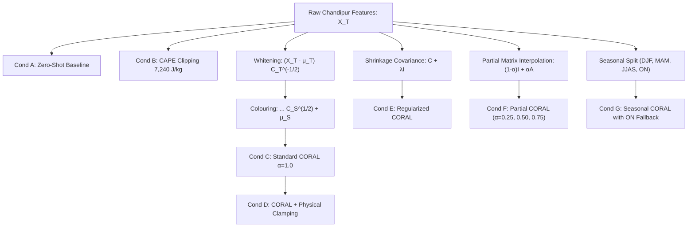

# CORAL and Multivariate Feature Adaptation Methodology

## 1. Executive Summary & Objective

This document defines the mathematical formulation, numerical algorithms, regularisation schemes, and physical boundary constraints for **Correlation Alignment (CORAL)** applied to the cross-region transfer of thunderstorm prediction models.

Within the **Thunderstorm Domain Adaptation Framework (TDAF)**, our objective is to adapt native Generalized Additive Models (`pyGAM`) and Explainable Boosting Machines (`InterpretML` EBM) trained on Florida ASOS/ERA5 data ($D_S$) to Chandipur ERA5 data ($D_T$) without modifying or retraining the underlying models. In Step 4, univariate CAPE boundary clipping was shown to remedy extreme extrapolation failure. In Step 5, we investigate whether aligning second-order multivariate statistics (feature covariance and correlation) across all six meteorological predictors further reduces domain shift or introduces unintended physical distortions.

---

## 2. Mathematical Formulation of CORAL

### 2.1 Theoretical Foundation

Correlation Alignment (Sun, Feng, & Saenko, 2016) seeks a linear affine transformation $A \in \mathbb{R}^{d \times d}$ and translation vector $b \in \mathbb{R}^d$ applied to target features $X_T \in \mathbb{R}^{N_T \times d}$ such that the distance between the second-order covariance matrices of the transformed target data $\hat{X}_T = X_T A + b$ and the source data $X_S \in \mathbb{R}^{N_S \times d}$ is minimised:

$$\min_{A, b} D_{\text{CORAL}}(\hat{X}_T, X_S) = \frac{1}{4d^2} \| C_{\hat{X}_T} - C_{X_S} \|_F^2$$

where $\|\cdot\|_F$ denotes the Frobenius matrix norm:

$$\| M \|_F = \sqrt{\sum_{i=1}^d \sum_{j=1}^d M_{ij}^2}$$

### 2.2 Sample Statistics

Let $d = 6$ denote the number of compatible meteorological predictors:
1. `cape_J_kg` (Convective Available Potential Energy)
2. `cin_J_kg` (Convective Inhibition)
3. `bulk_shear_850_300_ms` (Deep-layer bulk wind shear)
4. `cloud_cover_fraction` (Total cloud cover fraction)
5. `wind_speed_10m_ms` (10-metre horizontal wind speed)
6. `wind_speed_850hPa_ms` (850 hPa horizontal wind speed)

The sample means and unbiased covariance matrices of the source training domain ($N_S = 60,637$) and target domain ($N_T = 23,376$) are defined as:

$$\mu_S = \frac{1}{N_S} \sum_{i=1}^{N_S} x_{S,i}, \quad \mu_T = \frac{1}{N_T} \sum_{i=1}^{N_T} x_{T,i}$$

$$C_S = \frac{1}{N_S - 1} \sum_{i=1}^{N_S} (x_{S,i} - \mu_S)(x_{S,i} - \mu_S)^T$$

$$C_T = \frac{1}{N_T - 1} \sum_{i=1}^{N_T} (x_{T,i} - \mu_T)(x_{T,i} - \mu_T)^T$$

### 2.3 Closed-Form Whitening and Colouring Operator

Because the target data must be matched to the source feature distribution expected by the frozen Florida models, we apply **Target-to-Source CORAL**. The transformation consists of two distinct stages:
1. **Whitening (Sphering)**: Decorrelating target features and scaling their variances to unity by multiplying with $C_T^{-1/2}$.
2. **Colouring (Recorrelation)**: Imparting the source domain's covariance structure by multiplying with $C_S^{1/2}$ and shifting to the source mean $\mu_S$.

The complete transformation is:

$$\hat{X}_T = (X_T - \mathbf{1}_{N_T} \mu_T^T) C_T^{-1/2} C_S^{1/2} + \mathbf{1}_{N_T} \mu_S^T$$

The effective linear transformation matrix $A \in \mathbb{R}^{d \times d}$ is:

$$A = C_T^{-1/2} C_S^{1/2}$$

---

## 3. Numerical Implementation & Regularisation

### 3.1 Eigendecomposition and Matrix Roots

Both $C_S$ and $C_T$ are real symmetric positive semi-definite matrices. We compute their matrix square roots and inverse roots via spectral decomposition (eigendecomposition):

$$C = V \Lambda V^T$$

where $V$ is the orthogonal matrix of eigenvectors ($V V^T = V^T V = I$) and $\Lambda = \text{diag}(\lambda_1, \dots, \lambda_d)$ contains the real non-negative eigenvalues.

The fractional matrix powers are computed analytically:

$$C^{1/2} = V \Lambda^{1/2} V^T = V \text{diag}\left(\sqrt{\lambda_1}, \dots, \sqrt{\lambda_d}\right) V^T$$

$$C^{-1/2} = V \Lambda^{-1/2} V^T = V \text{diag}\left(\frac{1}{\sqrt{\lambda_1}}, \dots, \frac{1}{\sqrt{\lambda_d}}\right) V^T$$

### 3.2 Tikhonov Covariance Regularisation

In practice, meteorological features have widely differing scales (CAPE order $10^3$, cloud cover order $10^{-1}$), leading to high condition numbers. Furthermore, empirical covariance matrices may be ill-conditioned or nearly singular in localized sub-samples.

To guarantee positive definiteness and numerical stability, we add a Tikhonov regularisation shrinkage term $\lambda_{\text{reg}} I$:

$$C_S^{\text{reg}} = C_S + \lambda_{\text{reg}} I_d$$

$$C_T^{\text{reg}} = C_T + \lambda_{\text{reg}} I_d$$

where $I_d$ is the $6 \times 6$ identity matrix.
- In **Standard CORAL (Cond_C)**: $\lambda_{\text{reg}} = 10^{-6}$ (machine precision regulariser to prevent zero division).
- In **Regularized CORAL (Cond_E)**: $\lambda_{\text{reg}} = 0.05 \cdot \text{trace}(C) / d$, providing shrinkage toward spherical covariance.

Eigenvalues below a numerical threshold $\epsilon = 10^{-12}$ are clipped to $\epsilon$:

$$\lambda_i \leftarrow \max(\lambda_i, \epsilon)$$

---

## 4. Controlled Experimental Configurations

To thoroughly examine the behavior, benefits, and hazards of multivariate alignment, we implement seven strictly controlled experimental conditions:

### 4.1 Condition A: Original Zero-Shot Baseline
- Exact frozen predictions from Step 2 with no feature transformations.

### 4.2 Condition B: Univariate CAPE Boundary Clipping
- From Step 4: CAPE values exceeding the Florida training maximum ($7,240\text{ J/kg}$) are clamped to $7,240\text{ J/kg}$. All other features unchanged.

### 4.3 Condition C: Standard CORAL (Unconstrained)
- Full global alignment ($\alpha = 1.0$) using the whitening-colouring transformation.
- Evaluates the pure theoretical formulation of CORAL without heuristic safeguards.

### 4.4 Condition D: CORAL + Physical Domain Clamping
- Standard CORAL transformation followed by strict post-transformation boundary enforcement:
  - $\text{CAPE} \in [0, 7240]\text{ J/kg}$
  - $\text{CIN} \in [0, 1000]\text{ J/kg}$
  - $\text{Bulk Shear} \ge 0.0\text{ m/s}$
  - $\text{Cloud Cover} \in [0.0, 1.0]$
  - $\text{10m Wind Speed} \ge 0.0\text{ m/s}$
  - $\text{850 hPa Wind Speed} \ge 0.0\text{ m/s}$

### 4.5 Condition E: Regularized Covariance CORAL
- Covariance shrinkage with $\lambda_{\text{reg}} = 0.05$ applied before computing matrix roots.

### 4.6 Condition F: Partial Alignment (Interpolated CORAL)
- Parameterized by $\alpha \in \{0.25, 0.50, 0.75\}$:
  
  $$A(\alpha) = (1 - \alpha) I_d + \alpha A_{\text{CORAL}}$$
  
  $$b(\alpha) = \alpha (\mu_S - \mu_T A_{\text{CORAL}})$$
  
  $$\hat{X}_T(\alpha) = X_T A(\alpha) + \mathbf{1}_{N_T} b(\alpha)^T$$

### 4.7 Condition G: Seasonal CORAL with October-November Fallback
- Florida training data spans months 1 to 7 (January through July), corresponding to:
  - DJF (Winter): January–February
  - MAM (Pre-monsoon): March–May
  - JJAS (Monsoon): June–July (Florida data ends July 31)
  - ON (Post-monsoon): **0 training observations** in Florida ASOS.
- **Fallback Rule**: For Chandipur observations in October and November ($N = 3,904$), because Florida training data contains zero samples, seasonal CORAL falls back to the Florida annual training statistics $(\mu_S, C_S)$ while using Chandipur ON target statistics $(\mu_{T,\text{ON}}, C_{T,\text{ON}})$.

---

## 5. Algorithmic Diagnostics & Physical Validation Metrics

To measure both statistical convergence and physical plausibility, each experimental condition is evaluated against:
1. **Frobenius Covariance Distance**: $\| C_{\hat{X}_T} - C_{X_S} \|_F$.
2. **Mean Absolute Correlation Error**: Average absolute difference between feature correlation matrices.
3. **Domain Distinguishability (Adversarial Validation)**: A Logistic Regression classifier trained on a 50/50 balanced mix of Florida source data ($y=0$) and Chandipur data ($y=1$) under 5-fold cross-validation. An AUC of $0.50$ indicates indistinguishable distributions; an AUC of $1.00$ indicates complete domain separability.
4. **Physical Boundary Violations**:
   - Number and percentage of negative CAPE observations ($\text{CAPE} < 0$).
   - Number and percentage of negative CIN observations ($\text{CIN} < 0$).
   - Number and percentage of negative surface wind observations ($U_{10m} < 0$).
   - Number of observations where cloud cover fraction violates $[0, 1]$.
5. **Model Transfer Metrics**: F1 score, PR-AUC, ROC-AUC, Brier score, and Cohen's Kappa against Chandipur proxy labels using the frozen Florida optimal decision thresholds ($\tau_{\text{GAM}} = 0.33$, $\tau_{\text{EBM}} = 0.34$).
