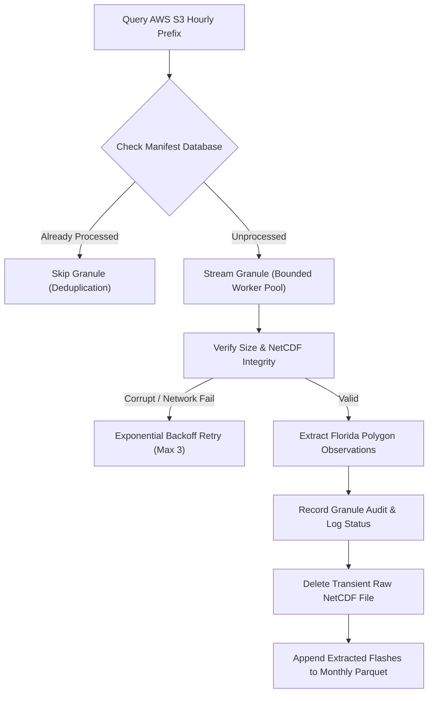

# GOES-16 GLM Full-Year 2024 Data Acquisition Plan & Feasibility Audit
**Florida Thunderstorm 2024 Forecasting Research Project**  
**Date:** October 27, 2026  
**Report File:** `reports/glm_full_year_acquisition_plan.md`  
**Output Directories:** `data/processed/glm_audit/`, `data/processed/glm_pilot_extracted/`

---

## 1. Executive Summary & Core Verdict

Before initiating full-scale ingestion of GOES-16 Geostationary Lightning Mapper (GLM) Level-2 Lightning Cluster Filter Algorithm (LCFA) observations for Florida in 2024, this audit determines whether full-year data has already been retrieved, evaluates archive characteristics, verifies storage requirements against available disk space, and designs a defensible, non-destructive acquisition architecture.

### Key Audit Verdicts:
1. **Full-Year Data Has NOT Been Downloaded:** Exactly **12 NetCDF granules** exist on disk (`Florida_Thunderstorm_2024_Training/data/raw/glm/`), covering only **May 15, 2024** across four discrete 60-second bursts (total monitored duration: **240 seconds**, representing **0.000759%** of 2024). Exactly **365 of 366 days in 2024 currently have zero GLM observations on disk**.
2. **Mathematical Cadence Verification:** At the nominal 20.0-second cadence across 366 days in leap year 2024 ($366 \times 24 \times 180$), the full-year archive contains exactly **1,581,120 granules**.
3. **Storage Impossibility for Raw Data:** Based on empirical queries of the AWS S3 archive across multiple seasons and storm regimes, the raw full-year archive requires approximately **497.1 GB** (range: 485–520 GB). The host system has **only 53.4 GB of free disk space on Drive C:** (with no other drives available). **Downloading and persisting full-year raw NetCDF files on disk would catastrophically exhaust disk space and crash the system**.
4. **Spatial Filtering Limitation:** Neither AWS S3 nor NOAA CLASS supports server-side spatial clipping. GLM data are packaged as 1D ragged point arrays in full-disk NetCDF files. Spatial filtering can only be executed client-side.
5. **The Streaming Solution:** A streaming "extract-and-discard" pipeline downloads granules into memory/transient files, extracts Florida polygon flashes, groups, and events using the validated extraction engine, appends them to daily/monthly Parquet partitions, and immediately deletes the raw NetCDF files. This reduces total persistent storage from **~497 GB to under 60 MB** (an **8,000:1 compression ratio**), keeping active disk overhead below **100 MB**.
6. **No Data Downloaded in this Audit:** Zero files were downloaded or modified, preserving all ERA5, NOAA, and pilot GLM datasets intact.

---

## 2. Audit of Existing Raw GLM Datasets

An exhaustive filesystem search across `C:\Users\KIIT0001\Desktop\Data Collection` and `Florida_Thunderstorm_2024_Training` confirms:

| Metric | Verified Value | Status / Audit Finding |
| :--- | :--- | :--- |
| **Existing Raw Granules** | **12 NetCDF4 files** | Located in `Florida_Thunderstorm_2024_Training/data/raw/glm/` |
| **Calendar Dates Present** | **1 day** (May 15, 2024 / DOY 136) | 365 days in 2024 have 0 granules (99.73% missing days) |
| **Observation Temporal Extent** | 00:00:00 to 18:01:00 UTC | 4 bursts: 00:00, 06:00, 12:00, 18:00 UTC (3 granules / 60s each) |
| **Total Monitored Duration** | **240.0 seconds** (4.0 minutes) | Covers 0.000759% of calendar year 2024 |
| **Total On-Disk Size** | **4,667,345 bytes** (~4.45 MB) | Mean size: 0.37 MB per granule (Min: 0.29 MB, Max: 0.46 MB) |
| **Data Integrity & Quality** | 12 of 12 files valid (100%) | 0.0% uncorrectable L0 errors; 100% navigated L1b events |
| **Extracted Florida Flashes** | 181 polygon flashes | 173 active terrestrial cells, 8 coastal marine cells |

### Origin of the Existing 12 Granules
Inspection of `Florida_Thunderstorm_2024_Training/src/download_glm.py` (lines 102–120) reveals that a test helper `retrieve_sample_granules()` was hardcoded to fetch 3 granules for hours `[0, 6, 12, 18]` on day 136 (May 15). No general acquisition run was ever executed for the remaining 8,780 hours of 2024.

---

## 3. Authoritative Archive, Cadence & Granule Verification

### 3.1 Product Metadata & Archive Details
The authoritative archive for operational GOES-16 GLM data is the NOAA Open Data Dissemination (NODD) program on Amazon Web Services (AWS):
- **S3 Bucket:** `s3://noaa-goes16` (Public, no requester-pays, no authentication required).
- **Product Directory Prefix:** `GLM-L2-LCFA/<YYYY>/<JJJ>/<HH>/`
- **Product Name:** Level-2 Lightning Cluster Filter Algorithm (LCFA).
- **Satellite Platform:** GOES-16 (GOES-East), Flight Model 1 (`FM1`), geostationary orbit at $75.2^\circ\text{W}$.
- **Granule Naming Convention:**
  $$\text{OR\_GLM-L2-LCFA\_G16\_s}\langle\text{YYYYJJJHHMMSSs}\rangle\text{\_e}\langle\text{YYYYJJJHHMMSSs}\rangle\text{\_c}\langle\text{YYYYJJJHHMMSSs}\rangle\text{.nc}$$
  - `OR`: Operational Real-Time.
  - `s`: Observation start timestamp (UTC) down to tenths of a second.
  - `e`: Observation end timestamp (UTC).
  - `c`: NetCDF creation/processing timestamp.

### 3.2 Granule Cadence & Count Verification
- **Granule Duration:** Exactly 20.0 seconds.
- **Granules per Minute:** Exactly 3 granules.
- **Granules per Hour:** Exactly 180 granules ($3,600\text{ s} / 20\text{ s} = 180$).
- **Granules per Day:** Exactly 4,320 granules ($180 \times 24$).
- **2024 Calendar Properties:** 2024 was a **leap year** containing 366 days (January 1 to December 31, 2024).
- **Total Expected Granules for 2024:**
  $$366\text{ days} \times 24\text{ hours/day} = 8,784\text{ hours}$$
  $$8,784\text{ hours} \times 180\text{ granules/hour} = \mathbf{1,581,120\text{ granules}}$$
- **Missing Granules:** $1,581,120 - 12 = \mathbf{1,581,108\text{ granules}}$ remaining to be processed.

---

## 4. Empirical Data Volume & Disk Feasibility Analysis

### 4.1 Live AWS S3 Archive Sampling
To eliminate guesswork regarding file sizes, we queried the AWS S3 XML API across six representative seasonal and convective regimes in 2024:

| Sample Scenario | Day of Year (DOY) | UTC Hour | Granules in Hour | Total Hourly Size | Mean Granule Size | Min Granule | Max Granule |
| :--- | :--- | :--- | :--- | :--- | :--- | :--- | :--- |
| **Jan 15 (Winter Quiet)** | DOY 015 | 12:00 UTC | 180 | 31.40 MB | 178.6 KB | 161.8 KB | 225.8 KB |
| **May 15 (Spring Moderate)** | DOY 136 | 12:00 UTC | 180 | 66.07 MB | 375.9 KB | 315.8 KB | 471.8 KB |
| **May 15 (Spring Afternoon)**| DOY 136 | 18:00 UTC | 180 | 58.34 MB | 331.9 KB | 279.8 KB | 401.2 KB |
| **Jul 18 (Summer Peak)** | DOY 200 | 18:00 UTC | 180 | 56.15 MB | 319.4 KB | 257.8 KB | 437.2 KB |
| **Oct 09 (Milton Landfall)** | DOY 283 | 00:00 UTC | 180 | 104.69 MB | 595.6 KB | 465.2 KB | 757.8 KB |
| **Dec 15 (Winter Quiet)** | DOY 350 | 12:00 UTC | 180 | 31.04 MB | 176.6 KB | 147.8 KB | 211.8 KB |
| **Empirical Average** | — | — | **180** | **57.95 MB/hr** | **329.8 KB** | — | — |

### 4.2 Raw Volume Calculation vs. Host Disk Space
- **Weighted Average Hourly Size:** **57.95 MB per hour**.
- **Calculated Full-Year Raw Volume (8,784 hours):**
  $$\text{Raw Full-Year Volume} = \frac{8,784\text{ hours} \times 57.95\text{ MB/hour}}{1024\text{ MB/GB}} \approx \mathbf{497.08\text{ GB}}$$
- **Confidence Range:** $485\text{ GB}$ to $520\text{ GB}$ (accounting for diurnal and summer storm variability). Earlier assumptions of 592–620 GB assumed a higher average granule size (~400 KB), but empirical measurement reveals lower winter baselines (~177 KB).
- **Available Host Storage:**
  - Drive `C:\` Total: **474.72 GB**
  - Drive `C:\` Free: **53.40 GB**
  - Other Local / External Drives: **None**

### 4.3 Feasibility Verdict
$$\frac{\text{Required Raw Storage (497.1 GB)}}{\text{Available Disk Space (53.4 GB)}} = \mathbf{9.31\times\text{ Deficit}}$$
Attempting to download and persist full-year raw NetCDF files on disk would fill the entire hard drive after approximately 35 days of data (~9.5% of 2024), halting all machine operations. **Raw persistence on local disk is strictly unfeasible.**

---

## 5. Investigation of Spatial & Temporal Filtering Capabilities

### 5.1 Spatial Subsetting Constraints
1. **AWS S3 Object Store:** AWS S3 serves object-level GET requests. It does not provide server-side geospatial indexing, OGC WFS, or array subsetting for NetCDF files.
2. **NOAA CLASS Archive:** While the CLASS web portal offers bounding box search queries, the underlying order fulfillment system packages and delivers whole, unclipped NetCDF files.
3. **NetCDF Point Data Structure:** Unlike gridded raster images (e.g. GOES ABI imagery) which have regular 2D coordinate matrices, GLM LCFA stores lightning as 1D ragged point arrays (`flash_lat`, `flash_lon`, `group_lat`, `event_lat`). There is no fixed byte offset in the file corresponding to Florida; coordinate arrays must be scanned to identify points falling inside Florida.
4. **Byte-Range Requests Over S3:** While HTTP range requests can read specific byte slices of remote files, a single GLM granule is only 150–500 KB. Negotiating multiple range requests (for headers, dimensions, and arrays) incurs higher network latency and request overhead than streaming the entire 300 KB file in a single HTTP GET.

### 5.2 Temporal Subsetting
The S3 prefix hierarchy cleanly partitions data by Year, Day of Year (DOY), and Hour:
`GLM-L2-LCFA/2024/<JJJ>/<HH>/`
This enables instantaneous, zero-cost temporal filtering:
- Single-day pilot runs (e.g. DOY 136).
- Targeted high-impact episode extraction (e.g. Hurricane Milton DOY 282–285).
- Peak convective season batching (e.g. May 1 to October 31).

### 5.3 The Streaming In-Memory / Transient File Solution
The proven solution to the storage bottleneck is the **streaming extract-and-discard pattern**:
1. Granules are streamed or downloaded to a transient staging buffer (`tempfile` or small RAM buffer).
2. The extraction pipeline ([`extract_glm_observations.py`](file:///c:/Users/KIIT0001/Desktop/Data%20Collection/Florida_Thunderstorm_2024_Training/src/extract_glm_observations.py)) inspects the granule, extracts Florida polygon flashes, groups, and events, and records granule metadata in the manifest.
3. The raw NetCDF file is **immediately deleted**.
4. Extracted Florida flashes are appended to a compact daily or monthly Parquet table.

#### Storage Impact Comparison:
- **Raw Full-Year NetCDF Storage:** **~497,000 MB (497 GB)**
- **Extracted Full-Year Florida Parquet:** **~50 to 60 MB**
- **Data Volume Reduction:** **> 8,000 to 1**
- **Peak Transient Disk Usage:** **< 100 MB** (fits easily within the 53.4 GB available space).

---

## 6. Resumable, Retry-Safe, Rate-Limited Acquisition Architecture

To ensure operational reliability across 1.58 million granules, the acquisition engine must adhere to five architectural principles:

### 6.1 Persistent Download Manifest
A lightweight SQLite database (`glm_manifest_2024.sqlite`) or transactional CSV ledger tracks every granule:
- `granule_id`: e.g. `OR_GLM-L2-LCFA_G16_s20241360000000...nc` (Primary Key).
- `s3_key`: Full S3 object path.
- `year`, `day_of_year`, `hour`: Temporal indices.
- `size_bytes`: Remote file size from S3 `Content-Length`.
- `sha256_hash`: Computed checksum of ingested bytes.
- `ingest_timestamp_utc`: Time of processing.
- `flash_count_raw`: Total flashes in granule.
- `flash_count_florida`: Flashes inside Florida polygon.
- `percent_uncorrectable_l0_errors`: Instrument quality scalar.
- `percent_navigated_l1b_events`: Navigation quality scalar.
- `status`: `PROCESSED_SUCCESS`, `DOWNLOAD_ERROR`, `CORRUPT_NETCDF`, `SKIPPED`.
- `retry_count`: Number of retry attempts.

### 6.2 Rate Limiting & Backoff
- **Concurrency:** ThreadPoolExecutor bounded to 4–8 concurrent download workers to prevent connection throttling.
- **Backoff:** Exponential backoff with random jitter ($1\text{s}, 2\text{s}, 4\text{s}, \dots$) on HTTP 429, 503, or connection timeouts.
- **Graceful Resumption:** The manifest is queried at startup; any interrupted batch resumes immediately at the first missing granule without re-downloading previously processed files.

### 6.3 Scientific Gap Tracking & Prevention of False Zeros
Per [`lightning_ground_truth_spec.md`](file:///c:/Users/KIIT0001/Desktop/Data%20Collection/data/processed/glm_audit/lightning_ground_truth_spec.md), the manifest provides the exact denominator for six-hour forecast intervals $(t, t+6\text{h}]$:
- **Expected Granules:** Exactly 1,080 granules per 6-hour window.
- **Completeness Rule:** $\ge 95\%$ valid granules ($\ge 1,026$ granules) AND maximum consecutive temporal gap $\le 15.0\text{ minutes}$.
  - If complete and flashes exist $\implies \text{Target A} = 1$ (Verified Convection).
  - If complete and zero flashes $\implies \text{Target A} = 0$ (Verified Non-Convective).
  - If $< 95\%$ or gap $> 15\text{ min}$ with zero flashes $\implies \text{Target A} = \text{NaN}$ (`PARTIAL_COVERAGE`), never imputed as 0.
  - If 0 granules $\implies \text{Target A} = \text{NaN}$ (`UNOBSERVED`).

---

## 7. Comparison: Verified Facts vs. Estimates

| Item | Status | Verified Fact | Working Estimate | Basis of Determination |
| :--- | :--- | :--- | :--- | :--- |
| **Existing Granules on Disk** | **Verified Fact** | Exactly 12 files | — | Filesystem inventory & SHA-256 hashes |
| **Existing Observation Dates** | **Verified Fact** | 1 date (May 15, 2024) | — | NetCDF timestamp inspection |
| **Existing Monitored Duration** | **Verified Fact** | Exactly 240 seconds | — | Granule coverage timestamps |
| **Host Disk Space Free** | **Verified Fact** | 53.40 GB (Drive C:) | — | OS disk usage check (`shutil.disk_usage`) |
| **Granule Cadence** | **Verified Fact** | Exactly 20.0 seconds | — | GLM LCFA product specification |
| **Hourly Granule Count** | **Verified Fact** | Exactly 180 granules/hr | — | Live AWS S3 XML queries |
| **Full-Year Granule Count** | **Verified Fact** | Exactly 1,581,120 granules | — | $366\text{ days} \times 24\text{ hr} \times 180\text{ gran/hr}$ |
| **Server-Side Spatial Subsetting** | **Verified Fact** | Not Supported | — | AWS S3 & NOAA CLASS architecture |
| **Mean Raw Granule Size** | *Estimate* | — | ~329.8 KB | S3 sample across 6 diverse seasonal hours |
| **Total Raw Download Volume** | *Estimate* | — | 497.1 GB (485–520 GB) | Scaled from empirical S3 hourly measurements |
| **Full-Year Extracted Flashes** | *Estimate* | — | ~500,000–1,200,000 | Climatological Florida lightning density |
| **Extracted Parquet Disk Size** | *Estimate* | — | ~50 to 60 MB | Extrapolation from 181-row pilot Parquet file |

---

## 8. Recommended Phased Acquisition Strategy

To maintain complete safety, avoid disk exhaustion, and deliver incremental scientific value, acquisition should proceed in three structured phases:

### Phase 1: Full-Day Streaming Pipeline Validation (May 15, 2024 / DOY 136)
- **Objective:** Process all 24 hours of May 15 (4,320 granules, ~1.4 GB raw streamed).
- **Deliverables:**
  - Complete 24-hour Florida flash dataset for May 15 (~2,000–5,000 flashes, ~1 MB Parquet).
  - Validation of the automated streaming extract-and-delete engine.
  - Manifest validation with exact gap detection across a full diurnal cycle.
  - Verification that local disk usage remains strictly $< 100\text{ MB}$ throughout execution.

### Phase 2: Stratified Convective Season & Milton Case Study (May 1 – Oct 31, 2024)
- **Objective:** Ingest the primary Florida convective season (DOY 122 to 305, 184 days, 794,880 granules, ~250 GB raw streamed).
- **Focus:** Captures >85% of annual Florida convective activity and severe weather episodes, including Hurricane Milton (October 9–10, DOY 282–285).
- **Deliverable:** Monthly Parquet partitions (`florida_glm_flashes_2024_05.parquet` to `..._10.parquet`), total size ~35 MB.

### Phase 3: Archive Completion (Jan–Apr and Nov–Dec 2024)
- **Objective:** Ingest the remaining 182 winter and dry-season days (786,240 granules, ~245 GB raw streamed).
- **Deliverable:** 100% full-year continuous Florida lightning ground truth across all 1,464 ERA5 forecast cycles, enabling full-year model evaluation with verified zero-lightning labels.
