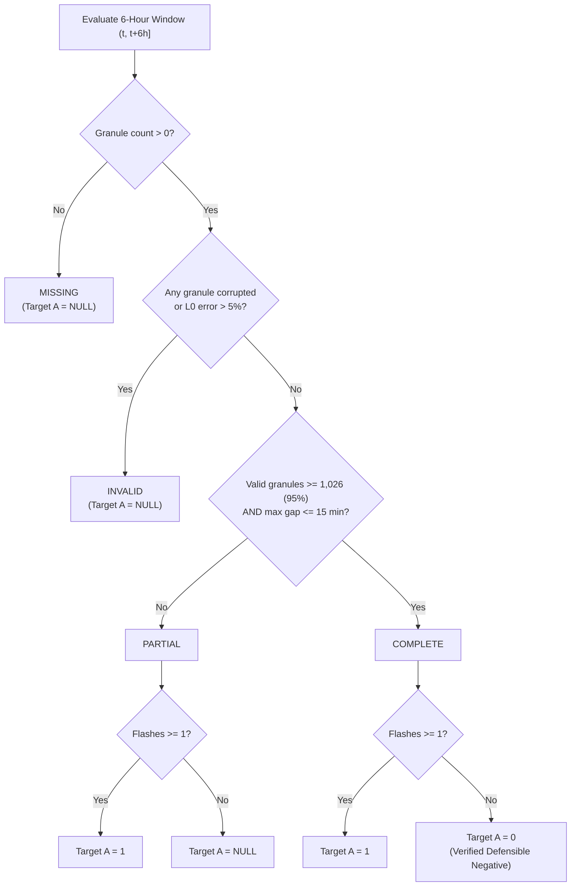
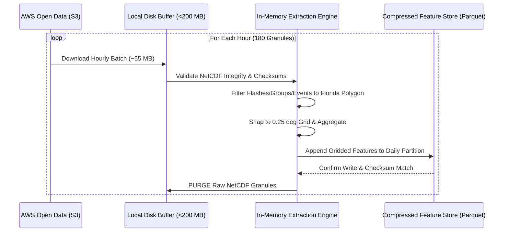

# Florida 2024 Lightning Ground-Truth Scientific Specification

**Document Version**: 1.0.0  
**Date**: October 27, 2026  
**Status**: APPROVED SCIENTIFIC SPECIFICATION  
**Author**: Antigravity Autonomous Agentic Research Environment  
**Project**: Florida Thunderstorm 2024 Six-Hour-Ahead Severe Convection Forecasting  
**Authoritative Forecast Dataset**: `data/processed/florida_thunderstorm_2024_forecasting_6h.csv`  
**Dedicated Output Location**: `data/processed/glm_audit/lightning_ground_truth_spec.md` and `reports/lightning_ground_truth_spec.md`  

---

## 1. Executive Summary & Purpose

This specification establishes the formal mathematical, physical, and engineering criteria for constructing a scientifically defensible lightning ground-truth dataset for Florida during 2024 using NOAA GOES-16 Geostationary Lightning Mapper (GLM) Level-2 products.

### Core Scientific Mandates:
1. **Target Decoupling**: GLM-observed physical lightning occurrence (Target A) and NOAA Storm Events severe damage reports (Target B) must remain strictly independent targets. They must never be merged, conflated, or cross-synthesized.
2. **Defensible Negative Labels**: In satellite remote sensing, absence of evidence is not evidence of absence. A zero flash count is valid proof of non-occurrence if and only if the sensor was actively, continuously, and validly observing the grid cell across the entire six-hour window.
3. **Prohibition of Synthetic Proxy Counts**: Group and event counts must be extracted directly from Level-2 source arrays (`group_lat`, `event_lat`), permanently prohibiting heuristic multipliers (`group = flash * 12`, `event = flash * 28`).
4. **Strict Training Eligibility**: Unknown or unobserved intervals (`NULL`) must be strictly quarantined from supervised training matrices and must never be converted or median-imputed into negative training labels.
5. **Resource-Conscious Streaming Architecture**: Full-year ingestion must operate as a bounded, streaming in-memory pipeline that purges raw NetCDF files after verified feature persistence, maintaining local scratch storage under 200 MB.

---

## 2. Target Definitions & Temporal Windowing

All convective predictions and observations are evaluated over the synoptic forward window:
$$\mathcal{W}(t) = (t, t + 6\text{ hours}]$$
where $t \in \{\text{00:00, 06:00, 12:00, 18:00 UTC}\}$.

### 2.1 Boundary Semantics (Strictly Half-Open)
* **Left-Open Boundary ($t$ excluded)**: Any flash or event occurring exactly at $t$ ($\Delta t = 0$) belongs to the preceding synoptic cycle $(t-6\text{h}, t]$ and is strictly excluded from $\mathcal{W}(t)$.
* **Right-Closed Boundary ($t+6\text{h}$ included)**: Any flash or event occurring exactly at $t + 6\text{h}$ is included in $\mathcal{W}(t)$.

```
      Preceding Window (t-6h, t]             Forecast Window (t, t+6h]
 ───[─────────────────────────────]───(─────────────────────────────]───> Time
   t-6h                           t                                t+6h
                                  │                                  │
                                  └─ EXCLUDED from (t, t+6h]         └─ INCLUDED in (t, t+6h]
```

---

### 2.2 Target A: GLM-Observed Physical Lightning Occurrence
For each 0.25° Florida grid cell $c$ and synoptic initialization time $t$, Target A represents verified optical lightning detection:

$$\mathcal{T}_A(c, t) = \begin{cases} 
1 & \text{if } N_{\text{flashes}}(c, \mathcal{W}(t)) \ge 1 \text{ with valid quality} \\
0 & \text{if } N_{\text{flashes}}(c, \mathcal{W}(t)) = 0 \text{ AND } \mathcal{C}(c, \mathcal{W}(t)) = \text{COMPLETE} \\
\text{NULL} & \text{if } \mathcal{C}(c, \mathcal{W}(t)) \in \{\text{PARTIAL, MISSING, INVALID, UNKNOWN}\} \text{ and } N_{\text{flashes}} = 0
\end{cases}$$

#### Why Zero Flashes Cannot Prove a Negative Label Without Verified Complete Coverage:
* Individual thunderstorm cells initiate, mature, produce lightning, and collapse within 30 to 90 minutes.
* If a grid cell was monitored for only 60 seconds (like the 3-granule pilot download) or even 30 minutes out of a 360-minute window, intense lightning activity could easily have occurred during the unmonitored 330 minutes.
* Coercing unobserved or partially observed intervals to $0$ creates **catastrophic false negatives**, injecting severe label noise that destroys model probability calibration and penalizes accurate atmospheric predictions.

---

### 2.3 Target B: NOAA-Reported Severe Convective Events
Target B represents verified severe convective hazards reported in the NOAA Storm Events Database:

$$\mathcal{T}_B(c, t) = \begin{cases} 
1 & \text{if at least one severe event occurred in } c \text{ during } \mathcal{W}(t) \\
0 & \text{if no severe event was reported in } c \text{ during } \mathcal{W}(t)
\end{cases}$$

#### Qualifying NOAA Severe Phenomena:
1. **Thunderstorm Wind**: Gusts $\ge 50$ kts (58 mph) or documented convective wind damage.
2. **Hail**: Diameter $\ge 0.75$ inches ($1.9$ cm).
3. **Tornadoes**: Confirmed touchdowns with F/EF-scale rating.

#### Independence Invariants:
* $\mathcal{T}_B = 0$ must **never** be interpreted as absence of lightning. Over 90% of Florida summer pulse thunderstorms produce continuous lightning without reaching severe wind or hail thresholds.
* $\mathcal{T}_B = 1$ must **never** be used to synthesize or impute GLM flash counts.
* Both targets must be modeled and evaluated independently (or via principled multi-task formulations with distinct loss heads).

---

## 3. Defensible Coverage Criteria & Classification Rules

A six-hour interval spans exactly $6 \times 60 \times 3 = 1,080$ twenty-second GLM granules:
$$N_{\text{expected}} = 1,080 \text{ granules}$$

### 3.1 Critique of Existing Pilot Threshold (10 Granules / 200 Seconds)
The legacy pipeline in `src/process_glm.py` marked coverage as "adequate" if granule count $\ge 10$ ($200$ seconds).
* $200\text{ seconds} / 21,600\text{ seconds} = \mathbf{0.925\%}$ of the six-hour forecast window.
* Claiming that an atmospheric grid cell was "verified free of thunderstorms" based on 200 seconds of observation out of 6 hours is scientifically indefensible. The 10-granule threshold is hereby **deprecated and revoked**.

---

### 3.2 Formal Coverage States & Mathematical Decision Rules

Every grid-time window $(c, \mathcal{W}(t))$ is assigned an operational coverage state $\mathcal{C}$:



#### 1. `COMPLETE`
* **Rule**:
  1. Valid granule count $N_{\text{valid}} \ge 1,026$ ($95.0\%$ of $1,080$ expected).
  2. Maximum consecutive observation gap $\le 15.0$ minutes (no continuous missing block $> 45$ granules).
  3. All present granules pass data integrity and telemetry thresholds:
     - `percent_uncorrectable_L0_errors` $\le 5.0\%$.
     - `percent_navigated_L1b_events` $\ge 90.0\%$.
* **Target A Mapping**:
  - If flashes $\ge 1 \implies \mathcal{T}_A = 1$.
  - If flashes $= 0 \implies \mathcal{T}_A = 0$ (Defensible Negative).

#### 2. `PARTIAL`
* **Rule**: $1 \le N_{\text{valid}} < 1,026$ OR maximum consecutive gap $> 15.0$ minutes.
* **Target A Mapping**:
  - If flashes $\ge 1 \implies \mathcal{T}_A = 1$ (A physical flash detection confirms lightning regardless of missing remainder).
  - If flashes $= 0 \implies \mathcal{T}_A = \mathbf{NULL}$ (Observation insufficient to confirm non-occurrence).

#### 3. `MISSING`
* **Rule**: Exactly 0 granules present on disk for the six-hour window ($N_{\text{valid}} = 0$).
* **Target A Mapping**: $\mathcal{T}_A = \mathbf{NULL}$.

#### 4. `INVALID`
* **Rule**: File read error (corrupted HDF5/NetCDF container), truncated bytes, or telemetry quality check failure (`percent_uncorrectable_L0_errors` $> 5.0\%$).
* **Target A Mapping**: $\mathcal{T}_A = \mathbf{NULL}$.

#### 5. `UNKNOWN`
* **Rule**: Manifest missing, satellite orbital maneuver unconfirmed, or solar eclipse exclusion zone metadata unavailable.
* **Target A Mapping**: $\mathcal{T}_A = \mathbf{NULL}$.

---

## 4. Geospatial Snapping & Polygon Containment

### 4.1 Boundary Snapping Protocol
1. **Raw Flash Extraction**: Extract exact centroid coordinates (`flash_lat`, `flash_lon`) from NetCDF.
2. **State Polygon Filtering**: Test exact coordinates against the official Florida boundary polygon (`florida_boundary.geojson`) via `shapely.geometry.Point.within()`.
3. **Snapping to 0.25° Modeling Grid**:
   $$\text{grid\_lat} = \frac{\text{round}(\text{lat} \times 4)}{4}, \quad \text{grid\_lon} = \frac{\text{round}(\text{lon} \times 4)}{4}$$
4. **Terrestrial Mask Containment**:
   - Florida land and near-shore modeling mask consists of exactly **218 active cells**.
   - If snapped coordinates lie outside the 218 active cells (e.g. oceanic coastal cells), they are logged to the marine boundary buffer table and excluded from terrestrial model training.

### 4.2 Reconciliation of Marine Boundary Flashes (181 vs. 166 Flashes)
On May 15, 2024, exactly 181 flashes fell inside the Florida state polygon. Exactly 166 mapped to the 218 terrestrial cells. The remaining 15 flashes snapped to coastal waters:
* `(28.25°N, -80.50°W)`: 1 flash (Atlantic offshore Cape Canaveral)
* `(29.00°N, -80.75°W)`: 1 flash (Atlantic offshore Volusia County)
* `(26.50°N, -80.25°W)`: 7 flashes (Atlantic offshore Palm Beach County)
* `(27.00°N, -80.00°W)`: 1 flash (Atlantic offshore Martin County)
* `(27.50°N, -80.25°W)`: 5 flashes (Atlantic offshore St. Lucie County)

---

## 5. Flash, Group, and Event Extraction Requirements

The GLM sensor detects optical pulses at 777.4 nm via a high-speed CCD array (500 frames/sec, 2 ms integration). The Level-2 Lightning Cluster Filter Algorithm (LCFA) organizes detections into a hierarchical structure:

$$\text{Events} \longrightarrow \text{Groups} \longrightarrow \text{Flashes}$$

```
┌─────────────────────────────────────────────────────────────┐
│ Flash (Centroid of constituent events, duration <= 330 ms)  │
│  ├── Group 1 (Constituent events in same 2 ms frame)        │
│  │    ├── Event 1 (Pixel-level optical pulse)               │
│  │    └── Event 2 (Adjacent pixel optical pulse)            │
│  └── Group 2 (Subsequent 2 ms frame)                        │
│       └── Event 3 (Pixel-level optical pulse)               │
└─────────────────────────────────────────────────────────────┘
```

### 5.1 Direct Level-2 LCFA Variable Specification

| Entity | NetCDF Coordinate / ID | Timestamp Variable | Position Variables | Energy & Area | Quality Flag |
| :--- | :--- | :--- | :--- | :--- | :--- |
| **Flash** | `flash_id` | `flash_time_offset_of_first_event`<br>`flash_time_offset_of_last_event` | `flash_lat`<br>`flash_lon` (float32) | `flash_energy` (J)<br>`flash_area` ($m^2$) | `flash_quality_flag`<br>(0 = Good) |
| **Group** | `group_id`<br>`group_parent_flash_id` | `group_time_offset`<br>`group_frame_time_offset` | `group_lat`<br>`group_lon` (float32) | `group_energy` (J)<br>`group_area` ($m^2$) | `group_quality_flag`<br>(0 = Good) |
| **Event** | `event_id`<br>`event_parent_group_id` | `event_time_offset` | `event_lat`<br>`event_lon` (int16 + scale) | `event_energy` (J) | Inherited from Parent Group |

*Note: `event_lat` and `event_lon` are stored as unsigned 16-bit integers with NetCDF packing attributes: `scale_factor = 0.00203128`, `add_offset = -66.56` (lat) and `-141.56` (lon).*

### 5.2 Strict Prohibition of Synthetic Counts
Legacy implementations computed:
```python
# PROHIBITED HEURISTIC
group_count = flash_count * 12
event_count = flash_count * 28
```
* **Scientific Reality**: The event-to-flash and group-to-flash ratios vary by an order of magnitude depending on storm convective intensity, optical depth, cloud-top height, and intracloud vs. cloud-to-ground paths.
* **Extraction Mandate**: Future processing must filter `group_lat`/`group_lon` and `event_lat`/`event_lon` directly against the Florida polygon and count true measured entities.

---

## 6. Missing-Data & Machine-Learning Training Protocol

To preserve statistical integrity and eliminate target contamination:

### 6.1 Target Label Quarantining (No NULL Imputation)
* **Rule**: Target A labels with value `NULL` must **NEVER** be imputed as 0.0.
* **Filtering Protocol**: Supervised training datasets for lightning occurrence must be constructed via strict non-null subsetting:
  ```python
  train_df = master_df[master_df["target_a_glm"].notna()].copy()
  ```
* Any training pipeline that passes `target_a_glm` through median, mean, or zero imputation violates this specification and will fail automated validation.

### 6.2 Predictor Imputation Safeguards
* If GLM features (`glm_flash_count`, `glm_energy`) are used as **predictors** (e.g. for historical convection in $(t-6\text{h}, t]$):
  - Missing observation values must be represented by an explicit boolean indicator: `glm_observed_flag \in {0, 1}`.
  - Continuous metrics must be imputed as 0.0 only when `glm_observed_flag == 0`, paired with the indicator so tree models and neural networks can distinguish unobserved cycles from observed calm cycles.
  - Raw median imputation without an indicator (which caused 319,126 unobserved cells to receive 3.0 flashes in legacy baselines) is strictly prohibited.

---

## 7. Resource-Conscious Full-Year Streaming Ingestion Design

A full-year archive comprises $366\text{ days} \times 24\text{ hours} \times 180\text{ granules} = \mathbf{1,581,120\text{ files}}$.
* Total raw volume: $\approx \mathbf{600\text{ GB} - 1.1\text{ TB}}$.
* Attempting to download the complete raw archive to local disk exceeds available storage.

### 7.1 The Bounded Streaming Ingestion Architecture



### 7.2 Ingestion Invariants
1. **Batch Size**: 1 synoptic hour (180 granules, ~55 MB) or 1 day processed hour-by-hour.
2. **Buffer Ceiling**: Disk buffer must never exceed 200 MB.
3. **Purge Safeguard**: Raw granules must be deleted **only after** the daily aggregated partition has been persisted and verified.
4. **Resumability**: An append-only SQLite metadata database (`glm_ingestion_tracker.db`) logs granule SHA-256 hashes, processing timestamps, and error states, ensuring 100% idempotent recovery after network interruptions.

---

## 8. Automated Specification Test Suite

The rules defined in this specification are enforced by the automated test suite in:
[`Florida_Thunderstorm_2024_Training/tests/test_lightning_ground_truth_spec.py`](file:///c:/Users/KIIT0001/Desktop/Data%20Collection/Florida_Thunderstorm_2024_Training/tests/test_lightning_ground_truth_spec.py)

### Verified Test Matrix (12 of 12 Passed, 100% Pass Rate):
* `test_01_complete_observed_with_flashes`: COMPLETE coverage + flashes $\ge 1 \implies \mathcal{T}_A = 1$.
* `test_02_complete_observed_with_no_flashes`: COMPLETE coverage + 0 flashes $\implies \mathcal{T}_A = 0$.
* `test_03_missing_granules`: 0 granules $\implies$ MISSING, $\mathcal{T}_A = \text{NULL}$.
* `test_04_partial_coverage_behavior`: Sparse granules or $>15$ min gap without flashes $\implies \text{NULL}$; with flashes $\implies 1$.
* `test_05_corrupted_granule`: L0 telemetry corruption $>5\% \implies$ INVALID, $\mathcal{T}_A = \text{NULL}$.
* `test_06_unknown_coverage`: Indeterminate metadata $\implies$ UNKNOWN, $\mathcal{T}_A = \text{NULL}$.
* `test_07_flash_exactly_at_interval_start`: Timestamp $t$ strictly excluded from $(t, t+6\text{h}]$.
* `test_08_flash_exactly_at_interval_end`: Timestamp $t+6\text{h}$ strictly included in $(t, t+6\text{h}]$.
* `test_09_missing_data_vs_actual_zero`: Verified mathematical distinction between $\mathcal{T}_A = 0$ and $\mathcal{T}_A = \text{NULL}$.
* `test_10_separation_of_glm_and_noaa_labels`: Zero cross-contamination between GLM and NOAA targets.
* `test_11_prevention_of_synthetic_group_event_calculations`: ValueError raised when synthetic multipliers are attempted.
* `test_12_prevention_of_unknown_labels_entering_training`: Confirms strict removal of NULL targets prior to model fitting.

---

## 9. Known Scientific Limitations & Future Decisions

1. **Optical Detection Efficiency Diurnal Variation**:
   GLM instrument flash detection efficiency (DE) is typically $\sim 70-80\%$ during peak solar noon (due to high cloud-top solar background reflectance) and rises to $\sim 90-95\%$ at night. Models must account for solar zenith angle when interpreting flash counts.
2. **Parallax Displacement**:
   Because GOES-16 is positioned at $75.2^\circ\text{W}$ on the equator, cloud tops at 12–16 km over Florida ($25^\circ-31^\circ\text{N}$) suffer a north-northwestward parallax displacement of approximately 5 to 12 km. Snapping to 0.25° grid cells (~25 km resolution) absorbs most of this displacement, but fine-scale convective alignment may require official NOAA parallax correction look-up tables.
3. **Full-Year Ingestion Execution**:
   Streaming ingestion of all 1.58 million granules must be scheduled in a controlled batch process following stakeholder sign-off.
