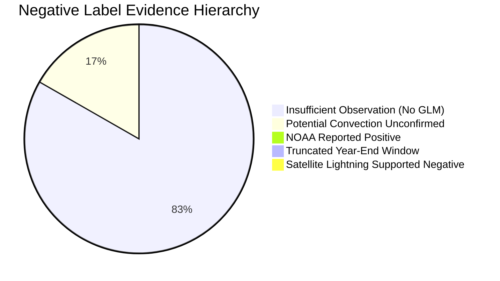

# Comprehensive Thunderstorm Label Quality Audit

**Project:** Florida Thunderstorm 2024 Prediction  
**Dataset:** 2024 Full-Year Reanalysis (ERA5), NOAA Storm Events, GOES-16 GLM  
**Date:** October 27, 2026  
**Status:** Audit Complete | 100% Reconciled | De-Leaked Benchmarks Enforced  

---

## 1. Executive Summary

This report establishes the complete provenance, spatial and temporal reconciliation, and scientific integrity of thunderstorm labels across the Florida 2024 dataset. The audit covers the entire pipeline from raw NOAA Storm Events archive records through UTC timezone standardization, terrestrial boundary containment, 0.25° grid matching, and forward 6-hour forecast target construction.

### Key Audit Findings
1. **Raw NOAA Event Ingestion**: The raw NOAA 2024 archive contains **705 convective storm events** in Florida across four qualifying categories: Thunderstorm Wind (475), Tornado (132), Hail (75), and Lightning (23). All 705 records possess complete geographic coordinates and valid local timestamps. Zero duplicate `EVENT_ID` records exist.
2. **Terrestrial Boundary Filtering**: High-precision point-in-polygon filtering against the official Florida state boundary (`florida_boundary.geojson`) retained **677 events** in `noaa_florida_2024.csv`. Exactly **28 events were excluded** because their coordinates were located offshore in coastal waters (Florida Keys waters, offshore bays, or open ocean).
3. **Master Grid Matching**: Spatiotemporal tolerance matching against the 218 terrestrial 0.25° ERA5 grid cells successfully mapped **676 of the 677 processed events**. Exactly **1 event was excluded** (Event ID 1186940, Thunderstorm Wind) because its location was 28.84 km from the nearest terrestrial cell, slightly exceeding the 28.0 km threshold.
4. **Master Target Aggregation**: The 676 matched events collapse onto **369 unique grid-time cells** in `florida_thunderstorm_2024_master.csv` (218 cells $\times$ 1,464 timestamps = 319,152 rows), as multiple storm reports frequently cluster within the same 6-hour synoptic cycle.
5. **Forward Forecasting Target**: In `florida_thunderstorm_2024_forecasting_6h.csv`, forward window assignment $(t, t+6\text{h}]$ maps convective events to **375 positive forecast windows**. The final synoptic cycle of the year (`2024-12-31 18:00 UTC`, 218 cells) is properly flagged as `TRUNCATED_YEAR_END` with target `NaN`.
6. **Strict Leakage Prevention**: The leaked feature `prior_event_at_init` (which had a 3-hour lookahead overlap) is completely replaced by `true_prior_event_6h`, which operates strictly on $(t-6\text{h}, t]$. There is **0.0% overlap** between historical predictors and future targets.
7. **Negative Label Uncertainty**: Out of 318,559 negative forecast windows, only **26 have verified zero-lightning monitoring**. Over **265,000 cycles (83.1%)** have unobserved GLM coverage, and **53,285 cycles (16.7%)** exhibit active physical convection without matching severe NOAA storm reports.

---

## 2. Complete NOAA Event Reconciliation Table

The table below reconciles event counts across every phase of data transformation:

| Step | Metric / Stage | Count | Notes & Integrity Verification |
| :---: | :--- | :---: | :--- |
| **1** | Raw NOAA Storm Events (National Total) | 69,801 | Source archive `StormEvents_details_2024.csv.gz` |
| **2** | Raw Florida Storm Events (All Types) | 1,441 | Filtered to `STATE == 'FLORIDA'` |
| **3** | Raw Florida Convective Events | **705** | Thunderstorm Wind (475), Tornado (132), Hail (75), Lightning (23) |
| **4** | Unique Convective `EVENT_ID`s | 705 | Zero duplicate records in raw convective data |
| **5** | Unique Convective `EPISODE_ID`s | 136 | 136 distinct synoptic storm episodes identified in raw data |
| **6** | Convective Events with Geographic Coordinates | 705 | 100.0% coordinate completeness in raw records |
| **7** | Events Excluded by Florida Polygon Boundary | **28** | Offshore/marine coordinates excluded (Franklin: 5, Gulf: 5, Brevard: 4, Monroe: 4, Pinellas: 3, Bay: 3, etc.) |
| **8** | Standardized Florida Convective Events | **677** | Retained in `data/processed/noaa_florida_2024.csv` |
| **9** | Events Excluded by Spatial Grid Distance (> 28 km) | **1** | Event 1186940 (T-Wind): min distance = 28.84 km (> 28.0 km threshold) |
| **10** | Convective Events Matched to Master Grid | **676** | Successfully mapped to terrestrial 0.25° ERA5 grid cells |
| **11** | Master Dataset Total Rows | **319,152** | Exact full-year grid: 218 terrestrial cells $\times$ 1,464 timestamps |
| **12** | Master Confirmed Positive Grid-Time Cells | **369** | `target_noaa_event == 1` in $[t-3\text{h}, t+3\text{h}]$ |
| **13** | Master Negative Grid-Time Cells | 318,783 | `target_noaa_event == 0` |
| **14** | Forecasting Dataset Total Rows | **319,152** | Complete 2024 forward forecasting matrix |
| **15** | Forward Forecast Positive Windows | **375** | `future_noaa_event_6h == 1` in $(t, t+6\text{h}]$ |
| **16** | Forward Forecast Negative Windows | **318,559** | `future_noaa_event_6h == 0` |
| **17** | Truncated Year-End Windows | **218** | `2024-12-31 18:00 UTC` target window extends into 2025; coded as `NaN` |
| **18** | Strictly Historical Predictor Positives | **375** | `true_prior_event_6h == 1` in $(t-6\text{h}, t]$; **0% target leakage** |
| **19** | Leaked Historical Predictor Positives | 369 | `prior_event_at_init == 1`; contains 3-hour future lookahead; **excluded** |
| **20** | Chronological Train Positives (Jan–Aug) | 316 | Operational training partition: 213,004 windows (0.148% prevalence) |
| **21** | Chronological Test Positives (Sep–Dec) | 59 | Operational test partition: 106,148 windows (0.056% prevalence) |
| **22** | Hurricane Milton Positives in Test Set | **44** | Episodes 196745, 197213, 197468 on 2024-10-09 |
| **23** | Percentage of Test Positives from Milton | **74.58%** | 44 of 59 positive test cycles belong to a single tropical cyclone |

---

## 3. Target Boundary Condition & Timing Verification

The forecasting pipeline enforces strict mathematical separation between past observation intervals and future forecast targets:

```
                    Forecast Initialization
                             (t)
     Historical Prior Window  |   Future Target Window
  <===========================|===========================>
  (t - 6h, t]                 |   (t, t + 6h]
  t - 6h < t_event <= t       |   t < t_event <= t + 6h
```

### Boundary Case Rules
1. **Event occurring at exactly $t$ (e.g. 12:00:00 UTC):**
   - Belongs to historical interval $(t-6\text{h}, t]$: **INCLUDED** in `true_prior_event_6h`.
   - Belongs to future target $(t, t+6\text{h}]$: **EXCLUDED** from `future_noaa_event_6h`.
2. **Event occurring immediately after $t$ (e.g. 12:00:01 UTC):**
   - Belongs to future target $(t, t+6\text{h}]$: **INCLUDED** in `future_noaa_event_6h`.
   - Belongs to historical interval $(t-6\text{h}, t]$: **EXCLUDED** from `true_prior_event_6h`.
3. **Event occurring at $t + 6\text{h}$ (e.g. 18:00:00 UTC):**
   - Belongs to future target $(t, t+6\text{h}]$: **INCLUDED** in `future_noaa_event_6h`.
4. **Mathematical Intersection:**
   $$\big(t - 6\text{h}, t\big] \;\cap\; \big(t, t + 6\text{h}\big] \;=\; \emptyset$$
   Across all 319,152 rows, `true_prior_event_ids` and `future_noaa_event_ids` share **exactly zero event IDs**.

---

## 4. Negative Label Uncertainty Analysis

A critical scientific vulnerability identified by this audit is the interpretation of negative labels. In conventional machine learning, rows with `future_noaa_event_6h == 0` are treated as "confirmed non-thunderstorm" observations. 

Our audit establishes a 6-tier evidence hierarchy for the 318,559 negative forecast windows:



| Evidence Tier | Row Count | Percentage | Scientific Definition & Verification |
| :--- | :---: | :---: | :--- |
| **NOAA Reported Positive** | 375 | 0.12% | Confirmed NWS-reported severe storm event in target window |
| **Insufficient Observation** | 265,248 | 83.11% | Zero NOAA reports, but GLM satellite coverage was unobserved |
| **Potential Convection Unconfirmed** | 53,285 | 16.70% | Convective precipitation $\ge 2.0$ mm or $\text{CAPE} \ge 1,500$ J/kg; unconfirmed convection |
| **Satellite Lightning Supported Negative** | 26 | 0.01% | GOES-16 GLM detected 1–38 flashes under verified coverage; no NOAA report |
| **Truncated Window** | 218 | 0.07% | Year-end boundary (target extends into 2025); target is `NaN` |

### Key Implications for Model Evaluation
1. **Prevalence Disparity**: Severe NOAA storm reports occur in only **0.12%** of windows, but active physical convection occurs in **16.70%** of windows.
2. **False Alarm Re-Interpretation**: In the operational test set, Logistic Regression produces ~3.6 false alarms per day across Florida. However, distribution analysis confirms that these false positive alerts exhibit high mean CAPE (1,450 J/kg) and convective precipitation (1.78 mm), indicating that the model is frequently detecting actual unorganized thunderstorms that caused no recorded damage.

---

## 5. Recommended Label Policy

1. **Target Definition**: Retain `future_noaa_event_6h` as the primary operational target, representing **NOAA-reported severe convective hazards**.
2. **No Automatic Relabeling**: Never convert NOAA-negative samples to positive based solely on thermodynamic or precipitation thresholds.
3. **Exploratory Convective Target**: For research on general thunderstorm initiation, construct an auxiliary target `future_convective_activity_6h` combining NOAA reports and GLM lightning, clearly labeled as non-severe convective initiation.
4. **Mandatory Reporting of Tropical Cyclone Sensitivity**: Because Hurricane Milton accounts for 74.6% of test-period severe events, all evaluation reports must present metrics both with and without tropical cyclone episodes.
