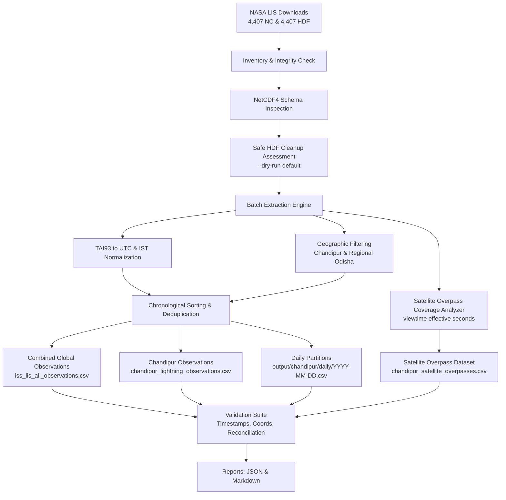
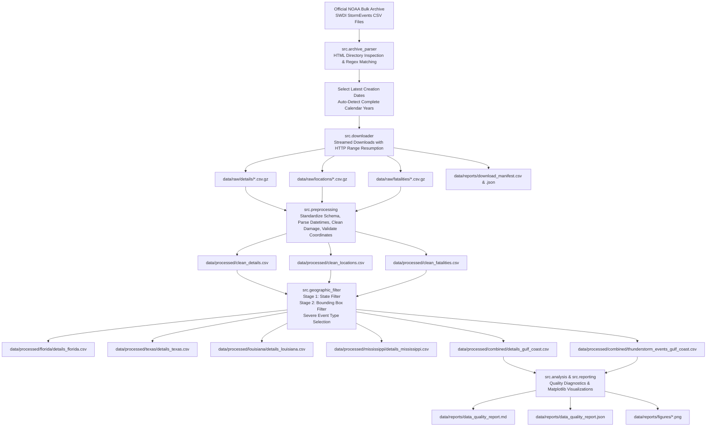

# NASA ISS-LIS Lightning Data Processing Pipeline for Thunderstorm Prediction

A robust, production-grade Python data processing pipeline for NASA's International Space Station Lightning Imaging Sensor (**ISS-LIS**) Quality Controlled Science Data V3.0 NetCDF (`.nc`) files.

Designed for machine learning thunderstorm prediction using NASA LIS lightning observations coupled with ECMWF ERA5 atmospheric reanalysis data over **Chandipur, Odisha, India**.

---

## Architecture & Workflow



---

## Key Features

1. **Precision Time Normalization**:
   - Accurately converts NASA LIS `TAI93` (seconds since 1993-01-01 00:00:00 TAI) into standard UTC and Indian Standard Time (`Asia/Kolkata`, UTC+05:30) with subsecond microsecond precision.
   - Computes normalized columns: `timestamp_utc`, `timestamp_ist`, `date_utc`, `date_ist`, `hour_utc`, `hour_ist`.

2. **Instrument Viewing & Satellite Coverage Modeling**:
   - Accounts for intermittent orbital passes using `viewtime` grid coverage (0.5° × 0.5° FOV cells).
   - Generates `chandipur_satellite_overpasses.csv`: marks exact overpass intervals, effective observation duration, and whether lightning was detected.
   - Prevents mislabeling missing satellite coverage as negative thunderstorm days (critical for ML training!).

3. **Geographic Study Region**:
   - **Chandipur Study Region**: Latitude 21.25°N to 21.50°N, Longitude 87.00°E to 87.25°E.
   - **Regional Sensitivity Box (Odisha & Bay of Bengal)**: Latitude 17.50°N to 23.50°N, Longitude 81.00°E to 89.00°E.
   - Fully configurable in `config/config.json`.

4. **Safe HDF Handling**:
   - Default dry-run mode: checks that every `.hdf` granule has an intact, non-empty, and readable `.nc` counterpart before designating it eligible.
   - Destructive deletion only occurs when explicitly passing `--delete-hdf`.
   - Never deletes `.nc` files or files outside the configured input folder.

5. **Strict Data Integrity**:
   - Reconciles row counts across manifests, daily files, and consolidated datasets.
   - Verifies coordinate ranges and chronological ordering.

---

## NASA Pipeline Directory Structure

```text
Data Collection/
├── config/
│   └── config.json                     # Pipeline configuration
├── scripts/
│   ├── __init__.py
│   ├── config_manager.py               # Config & logging setup
│   ├── inventory.py                    # Granule cataloging & integrity
│   ├── inspect_schema.py               # NetCDF4 schema inspection
│   ├── cleanup_hdf.py                  # Safe HDF cleanup operations
│   ├── time_utils.py                   # TAI93 to UTC & IST conversion
│   ├── geo_filter.py                   # Bounding box filters
│   ├── coverage.py                     # Viewtime satellite overpass coverage
│   ├── extractor.py                    # Batch NetCDF reader & science extraction
│   ├── combiner.py                     # Chronological sorting & daily partitioning
│   └── validator.py                    # 12-point integrity validation suite
├── output/
│   ├── reports/                        # JSON & Markdown reports & manifests
│   ├── chandipur/                      # Chandipur observations & daily files
│   │   ├── daily/                      # Daily YYYY-MM-DD.csv partitions
│   │   ├── chandipur_lightning_observations.csv
│   │   └── chandipur_satellite_overpasses.csv
│   ├── regional/                       # Regional sensitivity dataset
│   ├── combined/                       # All global observations
│   └── logs/                           # Runtime log file
├── main.py                             # Unified CLI
├── requirements.txt                    # Python dependencies
└── README.md                           # Documentation
```

---

## Installation & Setup on Windows

### Prerequisites

- Python 3.10+ installed on Windows.
- Windows PowerShell or Command Prompt.

### Install Dependencies

```powershell
pip install -r requirements.txt
```

---

## Running the Pipeline

### 1. Catalog Downloads (Inventory)
Scans the input directory, counts `.nc` and `.hdf` files, calculates storage sizes, pairs granules, and checks integrity:
```powershell
python main.py inventory
```

### 2. Inspect NetCDF Schema
Examines representative files, documents science variables, time encodings, and observation hierarchy:
```powershell
python main.py inspect
```

### 3. Safe HDF Cleanup
Assess deletion eligibility in safe **dry-run** mode (no files deleted):
```powershell
python main.py cleanup-hdf --dry-run
```

To permanently delete verified redundant `.hdf` files to reclaim disk space:
```powershell
python main.py cleanup-hdf --delete-hdf
```

### 4. Extract Observations
Extract lightning observations for calendar year 2023:
```powershell
python main.py extract --year 2023
```

### 5. Combine and Partition
Generate consolidated chronological CSVs and daily partitions:
```powershell
python main.py combine --year 2023
```

### 6. Validate Outputs
Run complete 12-point validation suite on output files:
```powershell
python main.py validate
```

### 7. Run Entire Pipeline End-to-End (`run-all`)
Executes inventory, schema inspection, extraction, coverage analysis, chronological combination, daily partitioning, and validation in one automated run:
```powershell
python main.py run-all --year 2023 --region chandipur
```

*(Note: `run-all` operates in dry-run mode for HDF files unless `--delete-hdf` is explicitly appended).*

---

## Configuration (`config/config.json`)

```json
{
  "input_dir": "c:/Users/KIIT0001/Desktop/Data Collection/NASA LIS DATA",
  "output_dir": "c:/Users/KIIT0001/Desktop/Data Collection/output",
  "observation_level": "flash",
  "year": 2023,
  "start_date": "2023-01-01",
  "end_date": "2023-12-31",
  "timezone": "Asia/Kolkata",
  "study_region": {
    "name": "chandipur",
    "lat_min": 21.25,
    "lat_max": 21.50,
    "lon_min": 87.00,
    "lon_max": 87.25
  },
  "regional_box": {
    "name": "odisha_regional",
    "lat_min": 17.50,
    "lat_max": 23.50,
    "lon_min": 81.00,
    "lon_max": 89.00
  }
}
```

---

## Output Datasets

| Output File | Description |
| :--- | :--- |
| `output/chandipur/chandipur_lightning_observations.csv` | Chronological lightning observations within Chandipur box |
| `output/chandipur/chandipur_satellite_overpasses.csv` | Every verified satellite overpass over Chandipur with observation duration and thunderstorm activity flag (0 or 1) |
| `output/chandipur/daily/YYYY-MM-DD.csv` | Daily observation files partitioned by UTC date |
| `output/regional/regional_lightning_observations.csv` | Sensitivity analysis observations for the larger Odisha region |
| `output/combined/iss_lis_all_observations.csv` | All global observations extracted across all processed granules |
| `output/reports/processed_granules.csv` | Granule-by-granule processing audit manifest |
| `output/reports/validation_report.json` | Complete machine-readable data integrity audit |

---

## NOAA Storm Events Automated Data Collection and Preprocessing Pipeline

A reliable, reproducible, and fully configurable Python pipeline for ingesting, standardizing, and filtering historical severe convective and thunderstorm data from the National Oceanic and Atmospheric Administration (**NOAA**) Storm Events Database.

This pipeline collects candidate US climatological analogues—**Florida, Texas, Louisiana, and Mississippi (Gulf Coast focus)**—for comparative thunderstorm analysis with **Chandipur, Odisha, India** (approximate reference coordinates: `21.46°N, 87.02°E`).

---

## NOAA Pipeline Architecture & Data Flow



---

## Key Capabilities & Design Principles

1. **Official Archive Compatibility**:
   - Parses `https://www.ncei.noaa.gov/pub/data/swdi/stormevents/csvfiles/` directly.
   - Extracts `StormEvents_details`, `StormEvents_locations`, and `StormEvents_fatalities`.
   - Groups files by year and dataset type, automatically choosing the latest creation date `c<timestamp>` when revisions exist.
   - Automatically detects complete calendar years (excluding the ongoing/incomplete calendar year).

2. **Network Resilience & Resumption**:
   - Downloads files via streaming with chunked buffers (512 KB).
   - Supports **HTTP Range resumption** (`Range: bytes={existing}-`), continuing interrupted downloads seamlessly.
   - Exponential backoff retry logic and gzip block validation before renaming `.tmp` files.
   - Maintains an auditable `download_manifest.csv` and `download_manifest.json`.

3. **Data Preprocessing & Standardization**:
   - Standardizes column names to lowercase stripped strings.
   - Safely parses dates and timestamps (`begin_date_time_parsed`, `end_date_time_parsed`).
   - Converts damage strings (`10.00K` -> `10,000`, `1.5M` -> `1,500,000`, `2.5B` -> `2,500,000,000`) into clean float columns (`damage_property_num`, `damage_crops_num`) while **preserving the original damage strings**.
   - Validates coordinates: detects missing coordinates, range violations outside `[-90, 90] x [-180, 180]`, and Null Island `(0.0, 0.0)`.
   - Never fabricates coordinates or dates; preserves records lacking coordinates by flagging them with `insufficient_coords = True`.
   - Removes exact duplicates and handles schema variances across older historical files gracefully.

4. **Two-Stage Geographic & Event-Type Filtering**:
   - **Stage 1**: State selection (`FLORIDA`, `TEXAS`, `LOUISIANA`, `MISSISSIPPI`).
   - **Stage 2**: Geographic bounding box / coastal plain focus.
   - **Event-Type Filtering**: Retains configured convective hazards (`Thunderstorm Wind`, `Hail`, `Lightning`, `Heavy Rain`, `Flash Flood`, `Tornado`, `Tropical Storm`, `Hurricane (Typhoon)`) without altering original `event_type` labels.
   - Separates event-level details and location-level coordinate tables via `event_id` to prevent inflated counts.

---

## NOAA Directory Structure

```text
data/
├── raw/
│   ├── details/       # Raw NOAA details CSV.gz files
│   ├── locations/     # Raw NOAA locations CSV.gz files
│   └── fatalities/    # Raw NOAA fatalities CSV.gz files
├── processed/
│   ├── clean_details.csv
│   ├── clean_locations.csv
│   ├── clean_fatalities.csv
│   ├── florida/       # details_florida.csv, locations_florida.csv, fatalities_florida.csv
│   ├── texas/         # details_texas.csv, locations_texas.csv, fatalities_texas.csv
│   ├── louisiana/     # details_louisiana.csv, locations_louisiana.csv, fatalities_louisiana.csv
│   ├── mississippi/   # details_mississippi.csv, locations_mississippi.csv, fatalities_mississippi.csv
│   └── combined/      # details_gulf_coast.csv, thunderstorm_events_gulf_coast.csv
├── reports/
│   ├── data_quality_report.md
│   ├── data_quality_report.json
│   ├── download_manifest.csv
│   ├── download_manifest.json
│   ├── event_counts_by_year.csv
│   ├── event_counts_by_state.csv
│   ├── event_counts_by_type.csv
│   ├── event_counts_by_month.csv
│   └── figures/
│       ├── event_counts_by_year_state.png
│       ├── event_types_distribution.png
│       ├── monthly_seasonality.png
│       └── spatial_distribution_map.png
└── logs/
    └── noaa_pipeline.log
```

---

## NOAA CLI Usage

Run subcommands via the `src.main` module:

### 1. Download Historical NOAA Data

Download raw details, locations, and fatalities files for specific years or default 10-year period:

```powershell
# Download default most recent 10 complete calendar years
python -m src.main download

# Download specific years (e.g. 2024)
python -m src.main download --start-year 2024 --end-year 2024

# Download only specific dataset types
python -m src.main download --start-year 2023 --end-year 2024 --types details locations
```

### 2. Preprocess & Clean

Clean raw data, validate coordinates, parse timestamps, and convert damage values:

```powershell
python -m src.main process
```

### 3. Filter Regions & Hazards

Apply two-stage filtering for candidate states and convective hazards:

```powershell
python -m src.main filter --regions florida texas louisiana mississippi
```

### 4. Generate Reports & Visualizations

Compute data quality audits, markdown reports, and summary charts:

```powershell
python -m src.main report
```

### 5. Run End-to-End Pipeline

Execute the full automated sequence in a single command:

```powershell
python -m src.main run-all --start-year 2024 --end-year 2024
```

---

## Configuration (`config.yaml`)

All parameters are centrally configurable in `config.yaml`:

- **Archive URL**: NOAA SWDI CSV endpoint, request timeouts, retry limit, and backoff factor.
- **Historical Period**: Default start/end years and automatic exclusion of ongoing incomplete years.
- **Geographic Filters**: State names, bounding box coordinates (`lat_min`, `lat_max`, `lon_min`, `lon_max`), and coastal focus areas.
- **Event Types**: Severe convective hazard types to retain.
- **Reference Site**: Chandipur, Odisha coordinates (`21.46°N, 87.02°E`).

---

## Testing & Validation

Run the comprehensive unit test suite via `pytest`:

```powershell
python -m pytest -v
```

All 19 unit tests validate:

- Regex-based archive parsing and link extraction from NOAA directory HTML.
- Selection of newest creation dates `c<date>` and exclusion of current incomplete year.
- Damage conversion (`10K` -> `10,000`, `1.5M` -> `1,500,000`, `2.5B` -> `2,500,000,000`, `0.00K` -> `0.0`).
- Coordinate validation (US bounds, Null Island `(0,0)`, missing values).
- Schema robustness for missing columns in legacy files.
- Two-stage geographic filtering and retention of records with missing coordinates (`insufficient_coords = True`).
- Preservation of original event types and associated location/fatality joins via `event_id`.
- ERA5 coordinate standardization (latitude descending, longitude normalized to `[-180, 180]`).
- ERA5 unit conversions (Kelvin to Celsius, meters to millimeters, 10m wind speed derivation).
- Seasonal date filtering across pre-monsoon (MAM), monsoon (JJAS), and post-monsoon (ON).
- Multi-variable standardized distance similarity calculation with sensitivity weighting schemes.

---

## ERA5 2024 Climate Similarity Pilot Study

### 1. Objective

Determine which US Gulf Coast candidate region has atmospheric conditions most similar to **Chandipur, Odisha, India** (`21.46°N, 87.02°E`) during calendar year **2024**, using the minimum required set of core atmospheric variables from ECMWF ERA5 reanalysis before proceeding to multi-year data collection.

### 2. Candidate Domains

| Region | Latitude Range | Longitude Range | Description |
| :--- | :--- | :--- | :--- |
| **Chandipur, Odisha** | 20.0°N to 23.0°N | 85.5°E to 88.5°E | Reference site (`21.46°N, 87.02°E`) |
| **Texas Gulf Coast** | 25.5°N to 30.5°N | 98.0°W to 93.5°W | Western Gulf Coast |
| **Louisiana & Mississippi** | 28.5°N to 31.5°N | 93.5°W to 88.0°W | Central Gulf Coast |
| **Florida Gulf Coast** | 24.5°N to 30.5°N | 86.0°W to 80.5°W | Eastern Gulf Coast |

*Note: CDS API bounding boxes are formatted as `[North, West, South, East]`. Coordinate normalization automatically wraps negative longitudes and ensures descending latitude ordering.*

### 3. Core Atmospheric Variables

1. **Convective Available Potential Energy (CAPE)** (`J/kg`): Atmospheric buoyancy for convection.
2. **Convective Inhibition (CIN)** (`J/kg`): Energy barrier suppressing convective initiation.
3. **Total-Column Water Vapour (TCWV)** (`kg/m²`): Atmospheric column moisture availability.
4. **2m Air Temperature** (`K` converted to `°C`): Near-surface thermal conditions.
5. **2m Dewpoint Temperature** (`K` converted to `°C`): Near-surface moisture content.
6. **Total Precipitation** (`m` converted to `mm`): Accumulated rainfall.
7. **10m Surface Wind Components** (`u10`, `v10` in `m/s`): Derived vector magnitude `sqrt(u10^2 + v10^2)`.

### 4. ERA5 Directory Structure

```text
data/
├── raw/
│   └── era5_2024/
│       ├── chandipur/             # era5_chandipur_2024_05.nc
│       ├── texas/                 # era5_texas_2024_05.nc
│       ├── louisiana_mississippi/ # era5_louisiana_mississippi_2024_05.nc
│       └── florida/               # era5_florida_2024_05.nc
├── processed/
│   └── era5_2024/
│       ├── era5_processed_chandipur_2024.nc
│       ├── era5_processed_texas_2024.nc
│       ├── era5_processed_louisiana_mississippi_2024.nc
│       └── era5_processed_florida_2024.nc
└── reports/
    └── climate_similarity_2024/
        ├── era5_download_manifest.csv
        ├── era5_download_manifest.json
        ├── seasonal_statistics.csv
        ├── climate_similarity_scores.csv
        ├── climate_similarity_report.md
        └── figures/
            ├── seasonal_distributions_comparison.png
            └── climatological_similarity_scores.png
```

### 5. ERA5 CLI Commands

```powershell
# Step 1: Download ERA5 data via Copernicus CDS API
python -m src.main era5-download --regions chandipur texas louisiana_mississippi florida

# Step 2: Preprocess NetCDF datasets (standardize coords, convert units, compute derived fields)
python -m src.main era5-process

# Step 3: Compute seasonal statistics, similarity distance scores, plots, and report
python -m src.main era5-similarity

# Or run the complete ERA5 pilot study end-to-end
python -m src.main era5-pilot
```
